# Bismuth kullanım kılavuzu

> Bu dosya programın içindeki kılavuzdan (`src/renderer/guide/content/tr/`) `npm run guide:docs` ile üretilir;
> elle düzenlemeyin. Programda: **Ayarlar → Kılavuz** ya da her ekranın üst çubuğundaki **?** düğmesi.

## İçindekiler

1. [Başlarken](#getting-started)
2. [Bugün ekranı](#today)
3. [Rezervasyon nasıl yazılır](#reservations)
4. [Ödeme alınca ne yapılır](#payments)
5. [Defter ve giderler](#ledger)
6. [Misafirler, firmalar, kara liste](#guests)
7. [Otelde kalanlar ve KBS](#in-house)
8. [Oda durumu ve arıza](#rooms)
9. [Kat görevlisi için](#housekeeping)
10. [Görevler ve bakım](#tasks)
11. [Vardiya devri ve notlar](#shift)
12. [Personel ve maaş](#staff)
13. [Rehber, tedarik, çamaşırhane, kayıp eşya](#operations)
14. [Döviz, hava, özel günler](#currency)
15. [Ay sonu kontrolü ve raporlar](#month-end)
16. [Bakanlık (turizm) istatistiği](#tourism)
17. [Yedek ve veri aktarma](#backup)
18. [Uzaktan erişim (Mac ve telefon)](#remote)
19. [Ayarlar, kullanıcılar ve roller](#settings)
20. [Sık sorulanlar ve sorun giderme](#faq)
21. [Kurulum ve yeni sürüm](#installation)

## 1. Başlarken

Bu bölüm programı ilk kez açan herkes içindir: oturum açmak, ekranı kilitlemek, dili değiştirmek, menüde yolunuzu bulmak ve takıldığınızda yardım almak.

### Bismuth nedir?

Bismuth otelin bütün günlük işini tek yerde tutar: rezervasyonlar, ödemeler, kasa, giderler, misafirler, oda temizliği, arızalar, görevler, vardiya devri ve personel. Excel'de ayrı ayrı sayfalarda tuttuğunuz bilgiler burada birbirine bağlıdır: bir ödeme yazdığınızda takvimdeki renk, deftere düşen satır ve kasadaki para birlikte değişir.

- Program **internet olmadan da** çalışır. İnternet yalnız döviz kuru, hava durumu ve bayram tarihleri gibi isteğe bağlı bilgiler için kullanılır.
- Verileriniz otelin kendi bilgisayarında durur; hiçbir yere gönderilmez.
- Hiçbir kayıt silinmez. Yanlış bir kayıt **iptal edilir**; kimin, ne zaman ve neden iptal ettiği saklanır.

### İlk kurulum

Program ilk kez açıldığında **kurulum sihirbazı** gelir. Otel sahibi bunu bir kez yapar; yaklaşık 10–15 dakika sürer. Adımlar sırasıyla şunlardır:

1. **Dil ve tema**: programın dili ve açık ya da koyu görünüm.
2. **Çalışma şekli**: bu bilgisayar tek başına mı çalışacak, otelin ana bilgisayarı mı olacak, yoksa başka bir Bismuth'a mı bağlanacak?
3. **Otel**: otelin adı, ülkesi, şehri, saat dilimi, giriş ve çıkış saatleri.
4. **Para birimleri**: toplamların hesaplandığı ana para birimi (çoğu zaman TRY, Türk lirası) ve kabul ettiğiniz dövizler.
5. **Oda tipleri**: otelinizdeki tipler ve önerilen gecelik fiyatları.
6. **Odalar**: kat sayısı ve kat başına oda sayısıyla odaları hızla oluşturursunuz; sonra numara, tip ve yatak sayısını tek tek düzeltirsiniz.
7. **Ödeme ve satış**: ödeme yöntemleri (nakit, kart, IBAN…), satış kanalları (doğrudan, Booking, Airbnb…) ve ek hizmetler.
8. **Personel ve vardiyalar**: izin ve ücret kuralları, vardiya saatleri, görev önerileri.
9. **Çalışanlar**: isterseniz çalışanları ekleyip kullanıcı hesabı açarsınız.
10. **Takvim**: vurgulanacak günler (örneğin hafta sonu), bayramlar ve gün kapatma.
11. **Sahip hesabı**: her şeyi gören ilk hesap; adınız, kullanıcı adınız, şifreniz ve isterseniz PIN.
12. **Özet**: bilgileri kontrol edip **Kurulumu bitir**'e basarsınız.

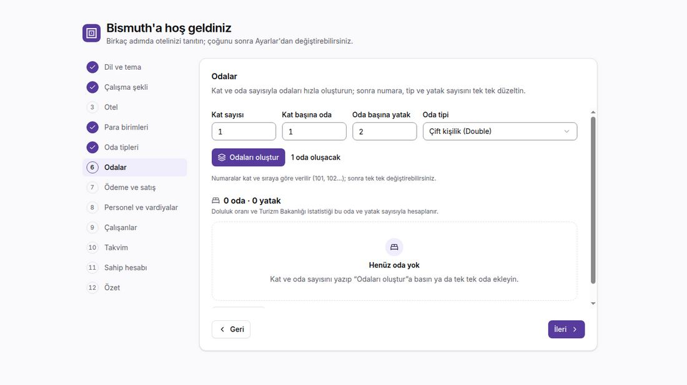

> [!WARNING]
> Kurulum bitince ekranda **kurtarma kodları** ile **Bismuth anahtarı** bir kez görünür. Bunları kâğıda yazın ya da kopyalayıp güvenli bir yerde saklayın. Şifrenizi unutursanız yeni şifreyi bu kodlardan biriyle belirlersiniz. **Kâğıda yazdım** kutusunu işaretlemeden programa geçilmez.

Programı bilgisayara kurmak için [Kurulum ve yeni sürüm](#installation) bölümüne bakın. Kurulumda verdiğiniz bilgilerin hemen hepsini sonra **Ayarlar**'dan değiştirebilirsiniz. Yalnız ana para birimi, rezervasyon ya da ödeme yazıldıktan sonra değiştirilemez.

### Oturum açmak

Herkes programa **kendi adıyla** girer. Böylece kim neyi yazdı, kim parayı teslim aldı, kim devri okudu, hep bellidir.

1. Oturum açma ekranında listeden **adınıza** tıklayın.
2. **PIN** ya da **Şifre** seçin. PIN'iniz varsa program önce PIN'i sorar.
3. PIN'inizi ya da şifrenizi yazıp <kbd>Enter</kbd>'a basın ya da **Oturum aç** düğmesine tıklayın.

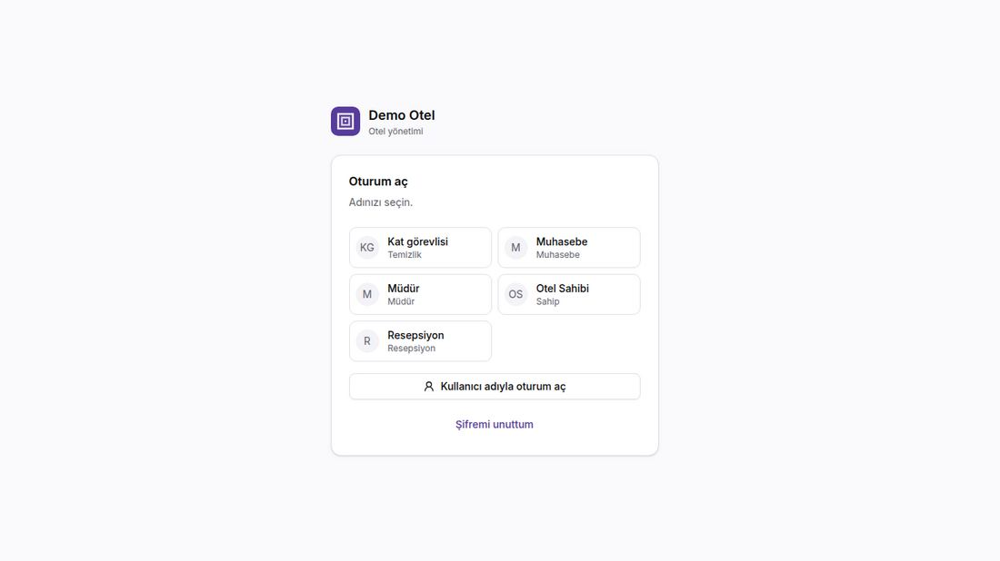

- Adınız listede yoksa **Kullanıcı adıyla oturum aç**'a basın; kullanıcı adınızı ve şifrenizi yazın.
- Size yeni bir hesap açıldıysa ilk oturum açışta **Yeni şifre belirleyin** ekranı gelir: size verilen geçici şifreyi ve iki kez yeni şifrenizi yazın, **Şifreyi kaydet**'e basın.
- Beş kez yanlış şifre girilirse hesap 15 dakika kilitlenir. Bu bir güvenlik önlemidir; bekleyin ya da şifrenizi yenileyin.

### Şifremi unuttum

1. Oturum açma ekranında **Şifremi unuttum**'a basın.
2. Kullanıcı adınızı ve kurtarma kodlarınızdan birini yazın.
3. Yeni şifrenizi iki kez yazıp **Şifreyi yenile**'ye basın.

Her kurtarma kodu bir kez kullanılır. Kodunuz yoksa otel sahibi şifrenizi **Ayarlar → Kullanıcılar ve roller** bölümünden sıfırlayabilir; size yeni bir geçici şifre verir.

### Hesap menüsü

Ekranın sağ üst köşesinde adınızın yazdığı düğme **hesap menüsünü** açar. Buradan:

- **Şifremi değiştir**: eski şifrenizi ve iki kez yenisini yazarsınız.
- **PIN ayarla** ya da **PIN'i değiştir**: 4–8 rakamlık PIN, listeden adınızı seçip hızlı oturum açmanız ve kilidi açmanız içindir. 1111, 1234 gibi kolay PIN'ler kabul edilmez.
- **Kurtarma kodlarını yenile**: yeni kodlar alırsınız; kullanılmamış eski kodlar geçersiz olur.
- **Kilitle** ve **Oturumu kapat**.

### Ekranı kilitlemek

Masadan kalkarken ekranı kilitleyin; başkası sizin adınıza kayıt yazamasın.

- Hesap menüsünden **Kilitle**'yi seçin ya da <kbd>Ctrl</kbd> + <kbd>L</kbd> (Mac'te <kbd>⌘</kbd> + <kbd>L</kbd>) tuşlarına basın.
- Kilidi açmak için PIN'inizi ya da şifrenizi yazıp **Kilidi aç**'a basın. Kaldığınız ekrana dönersiniz.
- Başka biri çalışacaksa kilit ekranında **Başka kullanıcıyla oturum aç**'ı seçer.
- Bir süre fare ve klavye kullanılmazsa pencere kendiliğinden kilitlenir. Bu süreyi otel sahibi **Ayarlar → Genel → Ekran kilidi** bölümünden seçer.

> [!TIP]
> Vardiya bitince **Oturumu kapat**'ı kullanın. Kilit, kısa süre ayrılmak içindir; oturumu kapatmak ise bilgisayarı sonraki kişiye bırakmak içindir.

### Dil, tema ve görünüm

Program Türkçe, İngilizce ve Rusça çalışır. Her kullanıcı kendi dilini seçer; birinin seçimi diğerini etkilemez.

1. Sol menüden **Ayarlar**'ı açın; **Genel** bölümü açılır.
2. **Dil** kutusundan dilinizi seçin. Menüler ve düğmeler hemen değişir.
3. Aynı bölümde **Tema** (Açık, Koyu, Bilgisayarla aynı), **Yoğunluk** (Rahat, Sıkışık), **Kuruşları göster** ve **Açılış ekranı** (Takvim ya da Bugün) seçimleri de vardır.

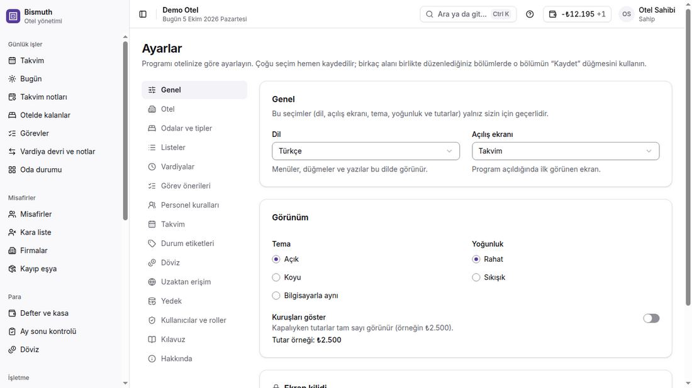

### Menü ve ekranlar

Bilgisayarda soldaki **kenar menü** bütün ekranları gruplar hâlinde gösterir: Günlük işler, Misafirler, Para, İşletme, Personel, Raporlar ve Sistem. Menüyü sol üstteki düğmeyle daraltıp genişletebilirsiniz. Menüde yalnız rolünüzün görebildiği ekranlar çıkar.

Üst çubukta soldan sağa: otelin adı ve bugünün tarihi, **Ara ya da git** kutusu, **?** (kılavuz) düğmesi, kasa durumu ve hesap menünüz.

- **Hızlı arama**: <kbd>Ctrl</kbd> + <kbd>K</kbd> (Mac'te <kbd>⌘</kbd> + <kbd>K</kbd>) ya da üstteki **Ara ya da git** kutusu. Bir ekranın adını yazıp <kbd>Enter</kbd>'a basın; dil ve tema da buradan değişir. Rehberdeki bir numarayı aramak için önce "rehber" yazın.
- Pencerelerde <kbd>Enter</kbd> kaydeder, <kbd>Esc</kbd> kapatır.

### Klavye kısayolları

Sık yapılan işler için fareye uzanmanız gerekmez. Bir yazı alanının içinde değilken şu tuşlara basın:

- <kbd>N</kbd>: **Yeni rezervasyon** penceresi açılır; hangi ekranda olursanız olun takvim açılır. Takvimde bir hücre seçiliyse rezervasyon o oda ve o gün için başlar.
- <kbd>P</kbd>: ödeme ekleme penceresi açılır. Bir rezervasyonun paneli açıksa ödeme o rezervasyona yazılır; değilse **Defter ve kasa** ekranında o günün ödemesi olarak açılır.
- <kbd>T</kbd>: takvim bugüne döner ve bugünün hücresi seçilir; oradan ok tuşlarıyla devam edebilirsiniz.
- <kbd>Ctrl</kbd> + <kbd>K</kbd> ya da <kbd>/</kbd>: hızlı arama.
- <kbd>?</kbd> ya da <kbd>F1</kbd>: bütün kısayolların listesi. Listeyi hızlı aramada "kısayol" yazarak da açabilirsiniz.

Bütün kısayollar:

**Her ekranda**

| | |
|---|---|
| Yeni rezervasyon | <kbd>N</kbd> |
| Ödeme ekle (açık rezervasyona, yoksa defterde) | <kbd>P</kbd> |
| Takvimde bugüne git | <kbd>T</kbd> |
| Hızlı arama | <kbd>Ctrl</kbd> + <kbd>K</kbd> ya da <kbd>/</kbd> |
| Kısayol listesini aç | <kbd>?</kbd> ya da <kbd>F1</kbd> |
| Ekranı kilitle | <kbd>Ctrl</kbd> + <kbd>L</kbd> |
| Kenar menüyü daralt ya da aç | <kbd>Ctrl</kbd> + <kbd>B</kbd> |
| Tam ekrana geç ya da çık | <kbd>F11</kbd> ya da <kbd>Ctrl</kbd> + <kbd>Shift</kbd> + <kbd>F</kbd> |
| Yakınlaştır ya da uzaklaştır | <kbd>Ctrl</kbd> + <kbd>+</kbd> ya da <kbd>Ctrl</kbd> + <kbd>-</kbd> |
| Yakınlaştırmayı sıfırla | <kbd>Ctrl</kbd> + <kbd>0</kbd> |

**Takvimde (bir hücre seçiliyken)**

| | |
|---|---|
| Hücreden hücreye geç | <kbd>←</kbd> <kbd>→</kbd> <kbd>↑</kbd> <kbd>↓</kbd> |
| Bir hafta ileri ya da geri | <kbd>Page Up</kbd> ya da <kbd>Page Down</kbd> |
| Bugüne dön | <kbd>Home</kbd> |
| Seçili hücreyi aç | <kbd>Enter</kbd> |
| Seçili hücrede yeni rezervasyon | <kbd>N</kbd> |
| Çubuğu seç ya da seçimden çıkar (Ctrl veya Shift + tık) | <kbd>Space</kbd> |
| Çubuğun ya da hücrenin işlem menüsü (sağ tık) | <kbd>Shift</kbd> + <kbd>F10</kbd> ya da <kbd>Menu</kbd> |

**Pencerelerde ve formlarda**

| | |
|---|---|
| Kaydet | <kbd>Enter</kbd> |
| Kaydetmeden kapat | <kbd>Esc</kbd> |
| Sonraki ya da önceki alan | <kbd>Tab</kbd> ya da <kbd>Shift</kbd> + <kbd>Tab</kbd> |

Tek tuşlu kısayollar bir yazı alanının içindeyken çalışmaz: bastığınız harf metne yazılır. Ctrl (Mac'te ⌘) ile olanlar her yerde çalışır.

> [!TIP]
> Mac'te <kbd>Ctrl</kbd> yerine <kbd>⌘</kbd> tuşunu kullanın. Rusça ya da başka bir klavye düzenindeyken de aynı tuşlar çalışır: program harfin yerine tuşun yerine bakar.

### Telefonda

Telefonda menü ekranın altındadır: **Bugün · Takvim · Misafir · Kasa · Daha fazla**. Diğer ekranlar **Daha fazla**'nın altındadır. Formlar alttan açılır; düğmeler parmakla rahat basılacak büyüklüktedir. Telefondan bağlanmak için [Uzaktan erişim](#remote) bölümüne bakın.

### Bu kılavuz

- Her ekranın üst çubuğundaki **?** düğmesi o ekranı anlatan bölümü açar.
- Kılavuzun tamamı **Ayarlar → Kılavuz** bölümündedir; sol menüde **Sistem** grubunda da **Kılavuz** vardır.
- **Kimin için** kutusuyla yalnız işinize yarayan bölümleri görebilirsiniz: Resepsiyon, Temizlik, Muhasebe, Sahip ve müdür.
- Arama kutusuna bir sözcük yazın (örneğin "kapora"); geçtiği yerler listelenir.
- **Bölümü yazdır** açık bölümü kâğıda basar.
- İlk oturum açışta görünen kısa **tanıtım turunu** **Tanıtım turunu başlat** düğmesiyle yeniden izleyebilirsiniz.

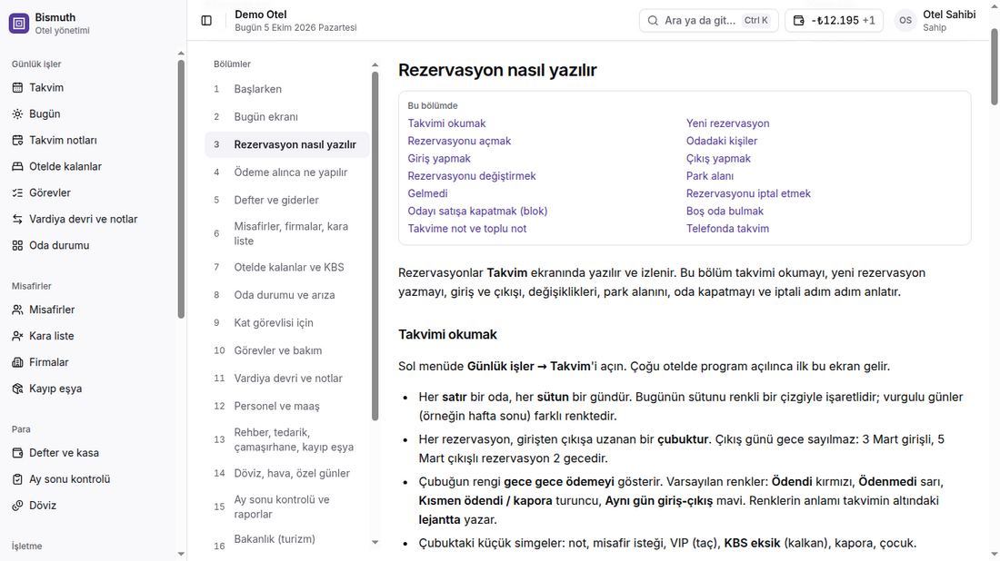

## 2. Bugün ekranı

Bugün ekranı günün özetidir: kim geliyor, kim çıkıyor, hangi oda kirli, kimin KBS bildirimi eksik, hangi görev bekliyor. Vardiyaya başlarken önce bu ekrana bakın.

### Ekranı açmak

Sol menüde **Günlük işler** grubundan **Bugün**'e tıklayın. Telefonda alt menüdeki ilk düğmedir. Ayarlar'da açılış ekranınızı **Bugün** yaparsanız program her açılışta buradan başlar.

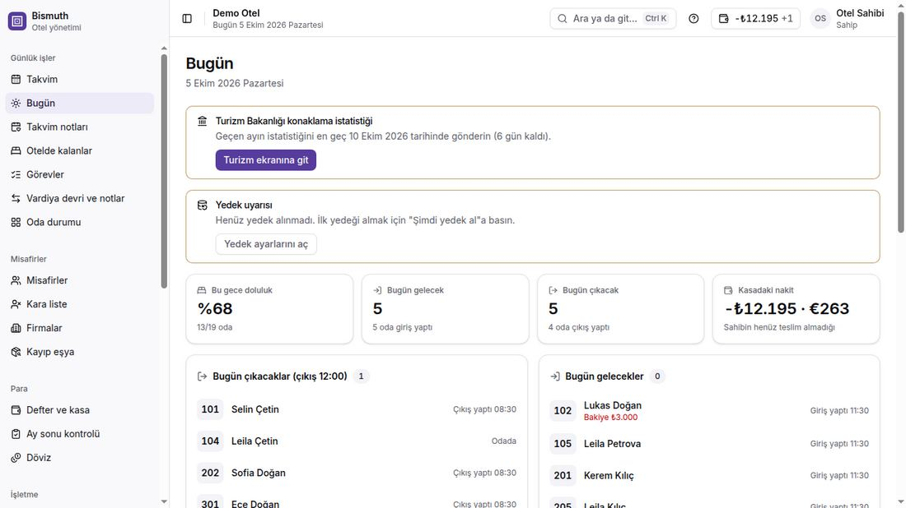

### Üstteki sayılar

Ekranın üstünde beş kutu vardır:

- **Bu gece doluluk**: bu gece kaç oda dolu (örneğin 14/19 oda).
- **Bugün gelecek**: bugün giriş yapacak odalar; altında kaçının giriş yaptığı yazar.
- **Bugün çıkacak**: bugün çıkış yapacak odalar; altında kaçının çıktığı yazar.
- **Kasadaki nakit**: sahibin ya da müdürün henüz teslim almadığı nakit.
- **KBS eksik**: otelde kalıp KBS'ye bildirilmemiş kişi sayısı. Sıfırdan büyükse kırmızıdır.

### Okunmamış vardiya devri

Önceki vardiya bir devir yazdıysa ve siz henüz okumadıysanız, ekranın en üstünde **Okunmamış vardiya devri** kutusu çıkar. **Devri oku**'ya basın; vardiya devri ekranı açılır. Okuyunca **Okudum**'a basmayı unutmayın. Ayrıntılar: [Vardiya devri ve notlar](#shift).

### Bugün çıkacaklar

Başlıkta otelin çıkış saati yazar (örneğin "çıkış 12:00"). Her satırda oda numarası, misafirin adı ve varsa ödenmemiş **Bakiye** kırmızıyla görünür.

- Misafir henüz odadaysa satırın sonunda **Odada** yazar.
- Çıkış saati geçtiği hâlde odadan çıkmamış misafirin satırı sarı çerçeveyle **Çıkış saati geçti** diye vurgulanır. Bu odaları arayın.
- Çıkış yapılmışsa satırda **Çıkış yaptı** ve saati yazar.
- Çıkışı takvimde rezervasyonu açıp **Çıkış yap** ile yaparsınız. Bkz. [Çıkış yapmak](#check-out).

### Bugün gelecekler

Bugün giriş yapacak misafirler. Giriş yaptıysa satırda **Giriş yaptı** ve saati yazar; henüz gelmediyse gece sayısı ve rezervasyon notu (örneğin "geç gelecek") görünür. Misafir gelince takvimde rezervasyonu açıp **Giriş yap**'a basın. Bkz. [Giriş yapmak](#check-in).

### Diğer kutular

Kutuların çoğunun sağ üstünde **Tümü** düğmesi vardır; o işin ekranını açar.

- **Bugünkü görevler**: bugün yapılacak ve geciken işler. Kutucuğu işaretleyince görev yapıldı olarak kaydedilir; kimin ve ne zaman yaptığı yazılır.
- **KBS eksikleri**: kimlik bildirimi yapılmamış kişiler, oda oda. KBS'ye girdikten sonra işaretini [Otelde kalanlar](#in-house) ekranından koyun.
- **Kirli odalar**: çıkış yapılan ve henüz temizlenmemiş odalar.
- **Açık arızalar**: çözülmemiş arızalar; bugün bildirilenler ayrıca işaretlidir.
- **Hava durumu**: otelin şehri için bugün ve bu hafta (internet varsa).
- **Sık aranan numaralar**: rehberde favori yaptığınız numaralar; tıklayınca kopyalanır, telefonda dokununca aranır.
- **Bugünün özel günleri**: bayramlar, fuarlar ve takvime yazdığınız notlar.
- Yetkiniz varsa personel durumu: bugün kim izinli, kimin ne kadar avansı var.
- **Çalışma saatlerim**: personel ekranını görmeyen çalışanlar geliş ve çıkış saatlerini buradan **Bugünün saatlerini gir** ile yazar.

> [!TIP]
> Ayın 1'i ile 10'u arasında ekranda **Turizm Bakanlığı konaklama istatistiği** hatırlatması çıkar. **Turizm ekranına git**'e basıp istatistiği hazırlayın. Bkz. [Bakanlık istatistiği](#tourism).

> [!WARNING]
> **Yedek uyarısı** kutusu görürseniz yedek alınamıyor demektir. **Yedek ayarlarını aç**'a basın ya da otel sahibine haber verin. Bkz. [Yedek](#backup).

### Bir kutu yüklenmezse

Bir kutuda "Bu bölüm yüklenemedi" yazıyorsa biraz sonra ekranı yeniden açın. Diğer kutular çalışmaya devam eder. Bir kutuyu hiç görmüyorsanız rolünüzün o bilgiye yetkisi yoktur.

## 3. Rezervasyon nasıl yazılır

Rezervasyonlar **Takvim** ekranında yazılır ve izlenir. Bu bölüm takvimi okumayı, yeni rezervasyon yazmayı, giriş ve çıkışı, değişiklikleri, park alanını, oda kapatmayı ve iptali adım adım anlatır.

### Takvimi okumak

Sol menüde **Günlük işler → Takvim**'i açın. Çoğu otelde program açılınca ilk bu ekran gelir.

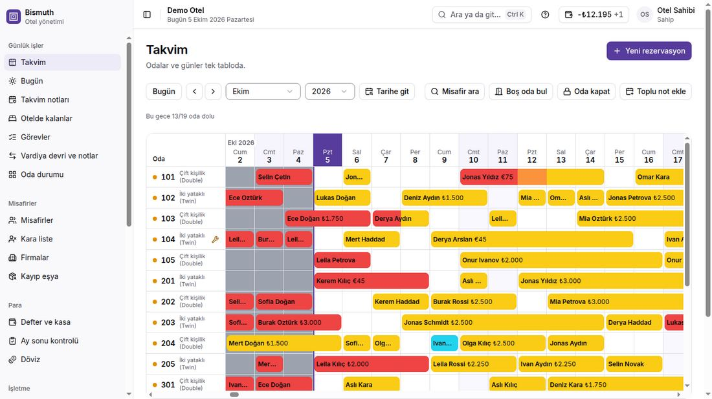

- Her **satır** bir oda, her **sütun** bir gündür. Bugünün sütunu renkli bir çizgiyle işaretlidir; vurgulu günler (örneğin hafta sonu) farklı renktedir.
- Her rezervasyon, girişten çıkışa uzanan bir **çubuktur**. Çıkış günü gece sayılmaz: 3 Mart girişli, 5 Mart çıkışlı rezervasyon 2 gecedir.
- Çubuğun rengi **gece gece ödemeyi** gösterir. Varsayılan renkler: **Ödendi** kırmızı, **Ödenmedi** sarı, **Kısmen ödendi / kapora** turuncu, **Aynı gün giriş‑çıkış** mavi. Renklerin anlamı takvimin altındaki **lejantta** yazar.
- Çubuktaki küçük simgeler: not, misafir isteği, VIP (taç), **KBS eksik** (kalkan), kapora, çocuk.
- Oda numarasının yanındaki renkli nokta odanın temizlik durumudur; anahtar simgesi açık arıza olduğunu gösterir.
- Kilitli ya da anahtar simgeli çizgili alan, odanın o günlerde **satışa kapalı** olduğunu gösterir.

Gezinme:

- **Bugün** düğmesi bugüne döner; oklar bir hafta ileri ya da geri gider.
- **Ay** ve **Yıl** kutularıyla istediğiniz aya atlarsınız; **Tarihe git** ile bir günü seçersiniz. Takvim en eski konaklamanın yılından (ya da **Ayarlar → Takvim → Takvim başlangıç yılı**ndan) bugünden on yıl sonrasına kadar gider.
- Gün başlığına tıklayınca o günün bayram ve notları açılır; oradan **Not ekle** ile not yazabilirsiniz.
- Klavyeyle: ok tuşları hücreler arasında gezer, <kbd>Page Up</kbd> / <kbd>Page Down</kbd> bir hafta atlar, <kbd>Home</kbd> bugüne döner, <kbd>Enter</kbd> seçili hücreyi açar, <kbd>N</kbd> yeni rezervasyon başlatır.

### Yeni rezervasyon

1. Takvimde misafirin kalacağı odanın, giriş gününe denk gelen **boş hücresine** tıklayın. Oda ve tarih kendiliğinden dolar. Ya da sağ üstteki **Yeni rezervasyon** düğmesine basın.
2. **Misafir** kutusuna adını yazın. Daha önce kalmışsa listede çıkar; seçin. Yeni bir misafirse listedeki **Yeni misafir: …** satırını seçin ve **Ad**, **Soyad**, **Telefon** (isteğe bağlı) alanlarını doldurun.
3. **Giriş** ve **Çıkış** tarihlerini kontrol edin. İki tarih aynı günse rezervasyon **aynı gün giriş‑çıkış** olarak kaydedilir.
4. **Odalar** listesinden odayı seçin. Bir grubun birden çok odası varsa hepsini işaretleyin. Seçilen tarihlerde dolu olan oda "dolu" diye yazılır.
5. **Satış kanalı**nı seçin (Doğrudan, Booking, Airbnb…). Kanalın verdiği rezervasyon numarası varsa **Kanaldaki rezervasyon no** alanına yazın.
6. **Durum**: kesinleşmişse **Kesin**, misafir henüz onaylamadıysa **Ön kayıt**.
7. Fiyat: **Gecelik fiyat (tüm geceler)** alanına fiyatı yazın. Program oda tipinin önerilen fiyatını ve hafta sonu ya da özel gün fiyatını altında gösterir; misafir daha önce kaldıysa **son ödediği fiyat** da yazar. Geceler farklı fiyatlıysa **Gece gece fiyat**'ı açıp her geceyi ayrı yazın.
8. İsterseniz **Etiketler** (Grup, VIP…) ve **Not** (örneğin "geç gelecek, bebek yatağı") ekleyin.
9. Alttaki özette gece sayısını ve toplamı kontrol edip **Kaydet**'e basın.

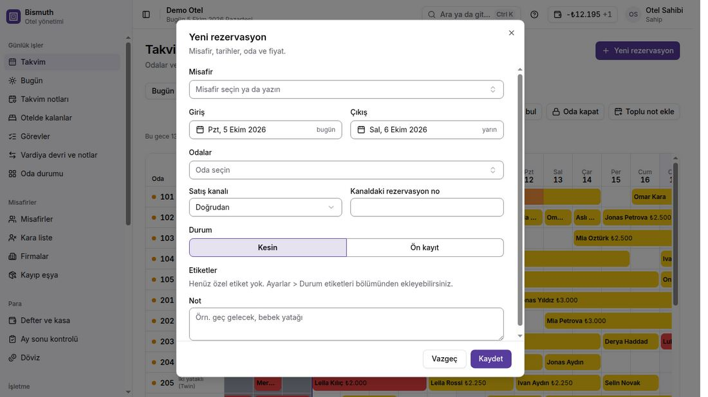

Rezervasyon takvimde hemen görünür; misafir kartı kendiliğinden açılır.

> [!WARNING]
> Misafir **kara listedeyse** pencerede kırmızı bir uyarı çıkar. Uyarıyı okuyup **Uyarıyı okudum, yine de kaydet**'i işaretlemeden kaydedilmez. "Engelle" olarak kayıtlı kişinin rezervasyonunu yalnız sahip ya da müdür kaydedebilir.

> [!TIP]
> Misafirin **önemli bir sürekli notu** varsa (örneğin "yüksek kat ister") kaydetmeden önce **Bu notu okudum**'u işaretlemeniz istenir. Bilgi düzeyindeki notlar sarı kutuda görünür.

### Rezervasyonu açmak

Takvimde bir çubuğa tıklayın; rezervasyon **paneli** yanda açılır (telefonda alttan). Üstte misafirin adı, oda, tarihler ve şu düğmeler vardır: **Giriş yap**, **Çıkış yap**, **Ödeme ekle** ve **Diğer işlemler** (üç nokta).

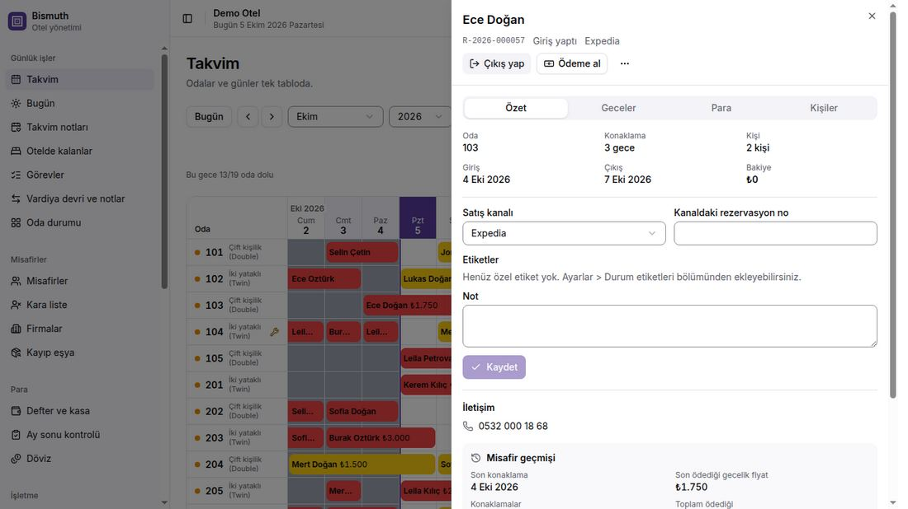

Panelin dört sekmesi vardır:

- **Özet**: kişi sayısı, bakiye, iletişim, misafirin geçmiş konaklamaları, notlar ve misafir notu.
- **Geceler**: her gecenin fiyatı ve ödeme durumu; tarihleri ve odayı değiştirme.
- **Para**: toplam tutar, ödenen, bakiye ve ödemeler listesi. Bkz. [Ödeme alınca ne yapılır](#payments).
- **Kişiler**: odada kalan her kişi ve KBS durumu.

Bir misafirin rezervasyonunu bulmak için takvimin üstündeki **Misafir ara**'ya ad, telefon ya da rezervasyon kodu yazın. Oda numarası yazarsanız (örneğin 302) önce o odanın bugüne en yakın konaklamaları gelir.

### Odadaki kişiler

Odada kalan **her kişi** ayrı satırdır; ilk satır rezervasyon sahibidir. Gece vardiyası kimin kim olduğunu bilsin diye her kişiye **tanıtıcı not** yazabilirsiniz (örneğin "kızıl saçlı, gözlüklü").

1. Panelde **Kişiler** sekmesini açın.
2. **Kişi ekle**'ye basın; **Ad soyad** ve isterseniz **Tanıtıcı not** yazın.
3. Kişiyi KBS'ye girdiyseniz **KBS'ye bildirildi** kutusunu işaretleyin; saat ve adınız kaydedilir.
4. **Kişi ekle** ile kaydedin.

Kimlik numarası Bismuth'ta sorulmaz ve saklanmaz; kimlik bilgisi yalnız KBS'ye girilir. KBS işaretlerinin tamamı için: [Otelde kalanlar ve KBS](#in-house).

### Giriş yapmak

Misafir otele geldiğinde:

1. Takvimde rezervasyonu açın.
2. **Giriş yap**'a basın. Birden çok oda varsa her oda için ayrı düğme çıkar ("Oda 102: giriş yap").
3. **Kişiler** sekmesinde odada kalan herkesi ekleyin ve KBS'ye girdikçe işaretleyin.

Giriş gününden önce giriş yapılamaz. Panelde kırmızı **KBS'ye bildirilmemiş kişi var** uyarısı görürseniz kişileri ekleyip KBS işaretlerini tamamlayın.

### Çıkış yapmak

1. Rezervasyonu açın; **Para** sekmesinde bakiye kaldıysa önce ödemeyi alın.
2. **Çıkış yap**'a basın.
3. Açılan pencerede KBS'den çıkışını yaptığınız kişileri **KBS çıkışı yapıldı** olarak işaretleyin.
4. **Çıkış yap** ile onaylayın.

Çıkıştan sonra oda kendiliğinden **Kirli** olur ve temizlik listesine düşer.

Misafir erken ayrılıyorsa çıkış penceresi kaç gecenin boşalacağını yazar ("2 gece boşalacak"); o geceler ve masrafları iptal edilir, oda yeniden satılabilir. Misafir giriş günü ayrılıyorsa ilk gece **aynı gün giriş‑çıkış** olarak kalır; **Aynı gün giriş‑çıkış ücreti** alanında ücreti değiştirebilirsiniz.

### Rezervasyonu değiştirmek

Panelde **Geceler** sekmesini açın:

- **Tarihleri değiştir**: yeni giriş ve çıkış tarihini seçip kaydedin. Giriş yapılmış konaklamanın giriş tarihi değişmez; yalnız çıkışı uzatıp kısaltabilirsiniz.
- **Başka odaya taşı**: yeni odayı seçip **Taşı**'ya basın. Oda o tarihlerde doluysa program söyler.
- **Oda ekle**: aynı rezervasyona ikinci bir oda ekler.
- Gece gece fiyat tablosunda bir gecenin fiyatını değiştirip **Fiyatları kaydet**'e basın.

Notlar **Özet** sekmesindedir: **Not ekle** ile yazın (örneğin "havaalanı transferi istedi").

### Park alanı

Takvimden çıkması gereken ama iptal edilmeyecek rezervasyonlar **park alanında** bekler: misafir gelmedi ama ödedi, iade bekliyor, ya da tarih ertelendi. Park edilince geceler boşalır, oda satılabilir; ödemeler kayıtta kalır.

1. Rezervasyonu açın; **Diğer işlemler → Park et**'i seçin.
2. **Park nedeni**ni seçin: **Gelmedi, ödedi**, **İade bekliyor**, **Ertelendi** ya da **Diğer**. İsterseniz not yazın.
3. **Park et** ile onaylayın.

Park edilen rezervasyonlar takvimin altındaki **Park alanı** kutusunda listelenir. Misafir yeni tarih için dönerse **Takvime al**'a basın; oda, tarih ve gecelik fiyatı seçin. Ödenenler aynen kalır. Para iade edilecekse **İade gir** ile iadeyi yazın.

### Gelmedi

Misafir hiç gelmediyse rezervasyonu açın ve **Diğer işlemler → Gelmedi olarak işaretle**'yi seçip onaylayın. Geceler boşalır, ödemeler kayıtta kalır; rezervasyon silinmez, "Gelmedi" olarak saklanır.

- Para iade edilecekse ya da misafir başka bir tarihte gelecekse önce **Park et** ile park alanına alın (neden: **Gelmedi, ödedi**). Park alanından **İade gir** ile iadeyi yazabilir, **Takvime al** ile yeni tarihe taşıyabilirsiniz.
- Park alanındaki bir kaydı sonradan da **Park kaydı işlemleri → Gelmedi olarak işaretle** ile kapatabilirsiniz.

### Rezervasyonu iptal etmek

1. Rezervasyonu açın; **Diğer işlemler → Rezervasyonu iptal et**'i seçin.
2. **İptal nedeni**ni yazın (zorunlu).
3. Rezervasyonda **tahsilat varsa** pencere tutarı yazar ("Bu rezervasyonda ₺1.500 tahsilat var") ve parayı ne yapacağınızı sorar:
   - **İade gir**: tutarı ve yöntemi seçin; iade, iptalle aynı anda defterin o gününe ve kasaya yazılır. Tutar tahsilatı geçemez.
   - **İade bekliyor olarak park et**: yalnız iade yetkisi olmayanlara görünür. Rezervasyon iptal edilmez, takvimin altındaki park alanında "İade bekliyor" olarak bekler; iadeyi yetkili kişi girer ve kaydı iptal eder.
   - **Tahsilat kalsın**: örneğin iptal bedeli; nedeni yazmak zorunludur ve kayda geçer.
4. **Rezervasyonu iptal et** ile onaylayın.

Geceler boşalır; ödemeler kayıtta kalır. Rezervasyon silinmez, "İptal edildi" olarak saklanır. Misafir otelde ise (giriş yapılmışsa) iptal yerine **Vazgeçme ve iade** kullanılır (aşağıda).

### Misafir girdi, vazgeçti: vazgeçme ve iade

Misafir odaya girdikten sonra vazgeçerse rezervasyonun **Diğer işlemler → Vazgeçme ve iade** satırını seçin. Üç yol vardır:

- **Aynı gün çıkış yap**: misafir giriş günü ayrılıyor. İlk gece "aynı gün giriş‑çıkış" olarak kalır; çıkış penceresinde ücreti düzeltebilirsiniz. Çıkış kaydedilince iade penceresi açılır ve alınan paranın fazlasını iade edersiniz.
- **Girişi geri al ve iptal et**: konaklama hiç olmamış sayılır. Yalnız giriş yapılan gün yapılabilir ve **Girişi geri alma** yetkisi ister (varsayılan: sahip ve müdür; sahip Ayarlar → Roller'den resepsiyona da açabilir). İptal nedenini yazın, tahsilat için yukarıdaki üç seçenekten birini seçin. Odada KBS'ye bildirilmiş biri varsa program uyarır; bildirim kayıtta kalır, çıkışı KBS tarafında ayrıca yapmanız gerekir.
- **Erken çıkış yap**: kalan geceler boşalır, kalınan geceler kalır.

Çıkış yapılmış, iptal edilmiş ya da gelmedi olarak kapanmış bir rezervasyonda da **Diğer işlemler** görünür: **İade gir** (tahsilat varsa), **Geçmiş** ve **Not ekle**. Resepsiyon rolü iade girebilir; bu yetkiyi sahip Ayarlar → Roller'den kapatabilir.

Rezervasyonun birden çok odası varsa yalnız bir odayı da iptal edebilirsiniz: **Diğer işlemler → Oda 102: iptal et**'i seçip **Odayı iptal et** ile onaylayın. O odanın geceleri boşalır; diğer odalar ve ödemeler kayıtta kalır.

### Odayı satışa kapatmak (blok)

Bir oda belirli günlerde satılmayacaksa (sahibin misafiri, boya, tadilat):

1. Takvimin üstünde **Odayı kapat**'a basın.
2. **Oda**, **İlk gün**, **Son gün** seçin.
3. **Tür**: **Satılmaz** (oda sağlam ama satılmayacak) ya da **Kullanım dışı** (oda kullanılamaz).
4. **Neden** yazın (örneğin "Sahibin misafiri") ve **Odayı kapat**'a basın.

Kapalı günler takvimde çizgili görünür. Kapatmayı kaldırmak için çizgili alana tıklayıp **Satışa aç**'a basın. Arızadan ya da oda durumundan gelen kapatma, o kayıt kapanınca kendiliğinden kalkar.

### Boş oda bulmak

Telefonda biri "şu tarihlerde boş oda var mı?" diye sorduğunda:

1. Takvimin üstünde **Boş oda bul**'a basın.
2. **Giriş** ve **Çıkış** tarihlerini, isterseniz **Oda tipi**ni seçin.
3. **Odaları bul**'a basın. Konaklamanın tamamında boş olan odalar takvimde işaretlenir.

İşareti **İşareti kaldır** ile silersiniz.

### Takvime not ve toplu not

Takvimin üstündeki **Toplu not ekle** aynı notu birçok güne ekler (örneğin her pazartesi "kahvaltı salonu kapalı"). Bayramlar ve özel günler için: [Döviz, hava, özel günler](#special-days).

### Telefonda takvim

Telefonda takvim bir **gün listesidir**: **Gelenler**, **Gidenler**, **Kalanlar** ve boş oda sayısı. Oklarla gün değiştirirsiniz. Bir satıra dokununca rezervasyon paneli alttan açılır.

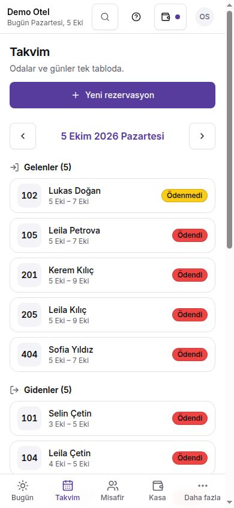

## 4. Ödeme alınca ne yapılır

Misafirden para aldığınız her seferde ödemeyi **hemen** Bismuth'a yazın. Ödeme bir kez yazılır; takvimdeki renk, defter, kasa ve raporlar kendiliğinden güncellenir. Bu bölüm ödeme almayı, dövizle ödemeyi, kaporayı, iadeyi, kasayı ve parayı teslim almayı anlatır.

### Rezervasyondan ödeme almak

En kolay yol, rezervasyonun kendi panelinden ödeme almaktır:

1. Takvimde rezervasyona tıklayın.
2. Panelin üstündeki **Ödeme ekle**'ye basın.
3. **Tür**: normal ödeme için **Ödeme**, önceden alınan para için **Kapora**.
4. **Tutar**'ı yazın ve yanındaki kutudan **para birimini** seçin (TRY, EUR, USD…).
5. **Ödeme yöntemi**ni seçin: Nakit, Kredi kartı, IBAN…
6. Gerekirse **Açıklama** yazın (örneğin "fiş no 1234").
7. **Kaydet**'e basın.

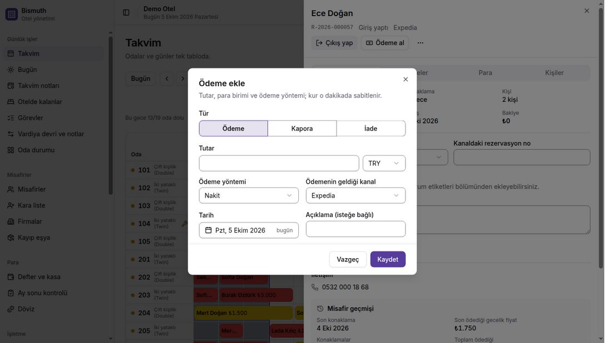

Kaydedince "Ödeme kaydedildi" yazar; takvimdeki çubuğun rengi değişir. Ödeme gecelere sırayla dağılır: önce ilk gece ödenmiş sayılır. Örneğin gecesi ₺2.000 olan 3 gecelik rezervasyonda ₺2.000 ödeme alınırsa ilk gece **Ödendi**, diğer ikisi **Ödenmedi** görünür.

Panelin **Para** sekmesinde **Toplam tutar**, **Ödenen** ve **Bakiye** ile bütün ödemelerin listesi vardır.

### Dövizle ödeme ve kur

Misafir Euro, Dolar ya da başka bir dövizle öderse tutarı **o dövizle** yazın; çevirmeyin.

- Pencerede "Kur 14:32 itibarıyla sabitlenecek" gibi bir satır görürsünüz: ödemenin ana para birimi karşılığı, kaydettiğiniz dakikadaki kurla hesaplanır ve **bir daha değişmez**. Kur ertesi gün değişse de bu ödemenin değeri aynı kalır.
- İnternet yoksa program son bilinen kuru kullanır; satırda "Son bilinen kur" işareti çıkar.
- Kur biliniyorsa elle kur alanı çıkmaz; yazdığınız tutar o kurla çevrilir. Otelin kendi kurunu kullanmak için kuru Döviz ekranında **Otel kuru** olarak girin.
- Yalnız o para birimi için hiç kur bilinmiyorsa (internet hiç gelmemişse) pencerede **Kur: 1 EUR kaç TRY** alanı çıkar; kuru elle yazın (örneğin 49,25). Bu kur yalnız o kayıtta kullanılır.
- Rezervasyonun hesabı başka bir dövizdeyse (örneğin EUR hesaba USD ödeme) tutar ana para birimi üzerinden çevrilir; kur yoksa ikinci bir elle kur alanı çıkar.

Otel kuru ve kur kaynakları için: [Döviz](#currency).

### Kapora

Rezervasyon için önceden para alındıysa (havale, kart ya da nakit) ödemeyi **Kapora** türüyle yazın. Kapora alınmış ama tamamı ödenmemiş geceler takvimde **Kısmen ödendi / kapora** rengiyle görünür; çubukta kapora simgesi çıkar.

### İade

Misafire para geri verildiyse ödeme penceresinde **Tür** olarak **İade**'yi seçin ve verilen tutarı yazın. Park edilmiş bir rezervasyonun parası iade edilecekse takvimin altındaki park alanında **İade gir**'i kullanın.

### Yanlış yazılan ödeme

Ödeme silinmez; düzeltilir ya da iptal edilir:

1. **Defter ve kasa** ekranını açın, ödemenin yapıldığı günü seçin.
2. Satırın sonundaki **Satır işlemleri** düğmesine basın.
3. Tutar ya da yöntem yanlışsa **Düzenle**; ödeme hiç olmamışsa **İptal et**'i seçin ve nedenini yazın.

İptal edilen satır üstü çizili kalır ve hiçbir toplama girmez. Kimin ve neden iptal ettiği denetim kaydına yazılır.

> [!WARNING]
> Sahip ya da müdür parayı **teslim aldıysa** (satırda "x" varsa) ödeme değiştirilemez. Önce kasa durumundan o teslimi geri almak gerekir.

### Ek satış (oda dışı)

Oda dışında bir şey satıldıysa (bavul emaneti, transfer, çamaşır):

1. **Defter ve kasa** ekranında **Ödeme ekle**'ye basın.
2. **Ne için** kutusunda **Ek satış**'ı seçin.
3. **Hizmet**, **Adet** ve **Birim fiyat**'ı girin; isterseniz misafiri seçin.
4. **Ödeme yöntemi**ni seçip **Kaydet**'e basın.

Defterden rezervasyona ödeme de girebilirsiniz: **Ne için → Rezervasyon**'u seçip misafir adı, oda ya da rezervasyon koduyla arayın.

### Kasa

Üst çubuktaki kasa düğmesi, kasada şu an kaç para **olması gerektiğini** gösterir. Tıklayınca **Kasa durumu** açılır:

- **Kasada olmalı**: para birimi başına nakit ödemeler; kasadan ödenen giderler ve avanslar bundan düşülür.
- **Teslim alınmamış tutarlar**: sahibin ya da müdürün henüz almadığı nakit, kart ve IBAN toplamları; kaç satırın beklediği ve en eskisinin tarihi.
- **Platformlar**: bu ay Booking, Airbnb gibi platformlardan gelen ödemeler.
- **Teslim geçmişi**: kim, ne zaman, ne kadar teslim aldı.

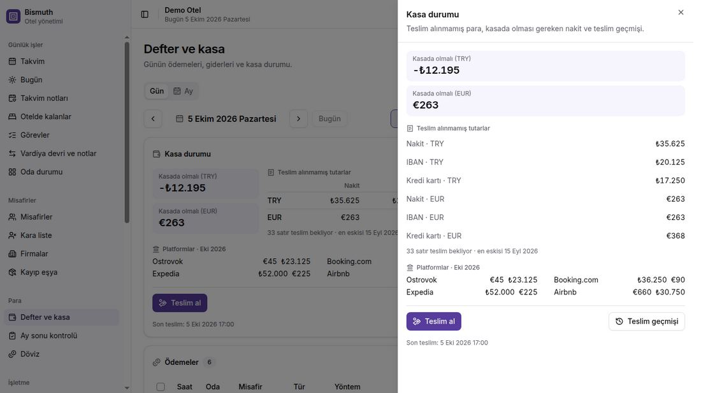

> [!TIP]
> Vardiya sonunda kasayı sayın ve "Kasada olmalı" ile karşılaştırın. Fark varsa defterin **Gün notu**'na yazın.

### Parayı teslim almak

Resepsiyonda biriken parayı **sahip ya da müdür** teslim alır. Kart ve IBAN satırları da banka ekstresiyle karşılaştırıldıktan sonra teslim alınmış sayılır; satıra **x** konur (Excel'deki x gibi).

1. Üst çubukta kasa düğmesine basın.
2. **Teslim al**'a basın.
3. Neyi teslim aldığınızı seçin: **Bugüne kadar hepsi** (nakit, IBAN ve kart), **Yalnız nakit** ya da defterde işaretlediğiniz **Seçili satırlar**.
4. **Teslim alacağınız** tutarı kasadaki parayla karşılaştırın; isterseniz not yazın (örneğin "kasa sayımı tuttu").
5. **Teslim al** ile onaylayın.

Defterde tek tek satır seçmek için: **Defter ve kasa** ekranında satırların başındaki kutuları işaretleyin ve **Teslim aldım** düğmesine basın.

Yanlışlıkla teslim aldıysanız **Teslim geçmişi**nde o kaydın **Teslimi geri al** düğmesine basın ve nedenini yazın. Kayıt silinmez; "Geri alındı" olarak kalır.

Parayı teslim alma yetkisi yalnız sahip ve müdürdedir; diğer roller kasa durumunu görür ama teslim alamaz.

## 5. Defter ve giderler

**Defter ve kasa** ekranı otelin günlük gelir‑gider defteridir: o günün ödemeleri, giderleri, günün özeti ve kasa durumu. Ödemeler rezervasyondan geldiği için deftere bir daha yazılmaz; burada giderleri, oda dışı satışları ve gerekirse rezervasyon ödemelerini girersiniz.

### Defteri açmak

Sol menüde **Para → Defter ve kasa**'yı açın. Telefonda alt menüdeki **Kasa** düğmesidir. Ekran bugünle açılır.

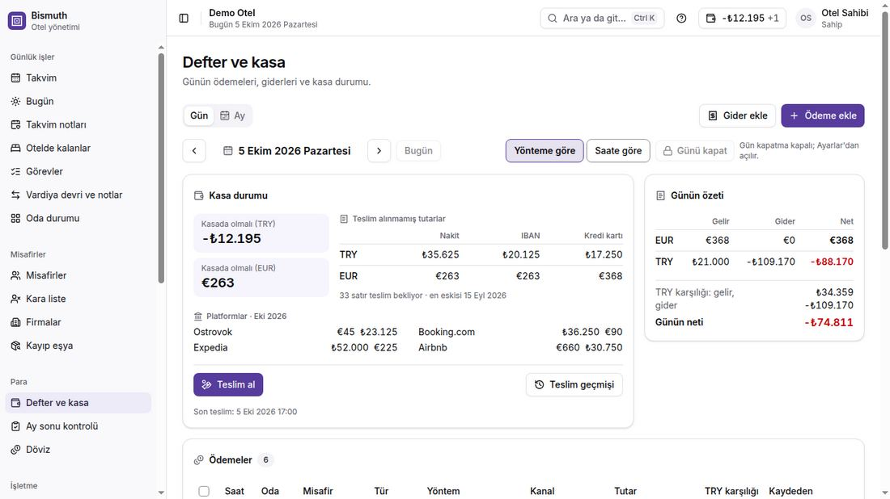

- **Gün** ve **Ay** düğmeleri gün görünümüyle ay görünümü arasında geçer.
- Oklarla önceki ya da sonraki güne gidin; tarihe tıklayıp bir gün seçin.
- **Sıralama**: ödemeleri **Yönteme göre** (Nakit, Kredi kartı, IBAN… grupları) ya da **Saate göre** dizer. Seçiminiz sizin için hatırlanır.

### Günün ödemeleri

**Ödemeler** tablosunda o gün alınan her ödeme bir satırdır: saat, oda, misafir, tür (ödeme, kapora, iade), yöntem, kanal, tutar, ana para birimi karşılığı ve kaydeden kişi.

- Satırın başındaki **x**, paranın sahip ya da müdür tarafından teslim alındığını gösterir. Bkz. [Parayı teslim almak](#handover).
- "Kur yok" işaretli satır, kaydedildiğinde kuru bilinmeyen dövizli ödemedir; ana para birimi toplamına girmez. Satırı açıp kuru elle yazabilirsiniz.

### Gider eklemek

Kasadan ya da bankadan çıkan her parayı gider olarak yazın: market, fatura, tamirci, kırtasiye…

1. **Gider ekle**'ye basın.
2. **Açıklama**'yı yazın (örneğin "Market (su, çay, şeker)"). Yazdıkça önceki açıklamalar önerilir; aynı yazımı seçmek raporlarda tek satır olmasını sağlar.
3. **Tutar**'ı ve para birimini yazın.
4. **Bölüm**'ü seçin (örneğin Genel). Sahibin özel giderleri için ayrı bir bölüm olabilir (**Sahip giderleri**); onu yalnız sahip görür. Bu bölümün giderleri **kasadan ödenmez**: sahip kasadaki parayı önce **Teslim al** ile alır, gideri sonra kasa dışından yazar. Böylece kasa her rolde fiziksel kasayla tutar.
5. **Ödeme yöntemi**ni seçin.
6. Para resepsiyon kasasından çıktıysa **Kasadan ödendi** açık kalsın; kasa durumundan düşülür.
7. İsterseniz **Ürün satırları**'na ürün, miktar ve birim fiyat girin. Ürün girerseniz fiyat değişimleri ve "en çok harcama" ürün grubuna göre izlenir.
8. **Kaydet**'e basın.

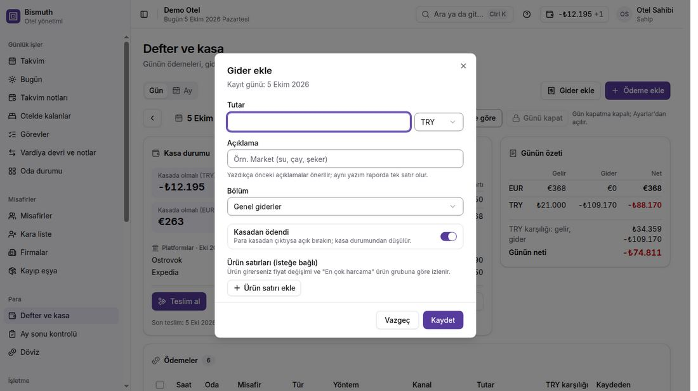

> [!TIP]
> Tedarikçiden toplu alım yaptıysanız gideri **Tedarik** ekranındaki **Alım gir** ile yazın; ürün fiyatları da güncellenir. Maaş ve avanslar **Personel** ekranından, çamaşırhane faturası **Çamaşırhane** ekranından gelir; bunlar defterde kilit simgesiyle görünür ve kendi ekranlarından değiştirilir.

Yanlış gideri **Gider işlemleri** düğmesinden **Düzenle** ya da **İptal et** ile düzeltin. İptal edilen gider silinmez, üstü çizili kalır.

### Günün özeti ve gün notu

**Günün özeti** kutusu ana para birimi karşılığıyla **Gelir**, **Gider** ve **Günün neti**'ni gösterir. **Gün notu**'na o günle ilgili önemli bir şeyi yazın (kasa farkı, izin, olay) ve altındaki **Kaydet**'e basın.

Görme yetkiniz olmayan bir gider bölümü ya da maaş ödemesi varsa ekranda **Kısmi görünüm** yazar; toplamlar yalnız gördüğünüz satırlardan hesaplanır. Kasadan yapılan personel ödemeleri (avans, nakit maaş) kasa hareketi olduğu için kasayı görebilen herkese görünür.

### Ay görünümü

**Ay**'a basınca ayın her günü bir satırda görünür: gelir, gider ve net. Üstte **Ay toplamları** vardır. Bir güne tıklayınca **Günü göster** ile o güne geçersiniz.

### Açıklama sözlüğü

Aynı gider farklı yazılmış olabilir ("market", "Market alışverişi", "MARKET"). **Açıklama sözlüğü**'nü açın; yazımları görür, **Yeniden adlandır** ya da **Birleştir** ile tek ada toplarsınız. Tutarlar değişmez; yalnız raporlardaki gruplama düzelir.

### Gün kapatma

Bazı oteller her gece günü kapatır; kapanan güne sonradan kimse habersiz kayıt ekleyemez. Bu özellik varsayılan olarak kapalıdır; otel sahibi **Ayarlar → Takvim → Gün kapatma** bölümünden açar.

1. Açıksa defterde o günün üstünde **Günü kapat** düğmesi görünür.
2. Basınca "… kapatılsın mı?" diye sorar; onaylayın.
3. Gün **Kapalı gün** olarak işaretlenir.

Kapalı bir güne kayıt eklemek ya da değiştirmek için yetki gerekir ve **Kapalı gün gerekçesi** yazılır; her değişiklik denetim kaydına girer. Yetkili kişi **Günü aç** ile günü yeniden açabilir.

## 6. Misafirler, firmalar, kara liste

Her misafirin bir **kartı** vardır: iletişim bilgileri, geçmiş konaklamaları, ödediği fiyatlar, sürekli notları ve firması. Kart ilk rezervasyonla kendiliğinden açılır; aynı misafiri bir daha yazmanız gerekmez.

### Misafir aramak

Sol menüde **Misafirler → Misafirler**'i açın (telefonda alt menüdeki **Misafir**).

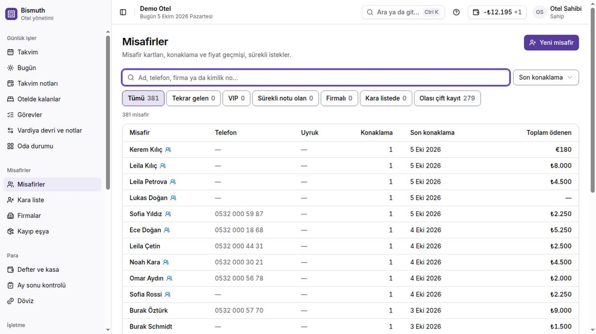

1. Arama kutusuna ad, soyad, telefon ya da firma yazın. Türkçe harf farkı önemli değildir.
2. **Filtre** ile listeyi daraltın: **Tekrar gelen**, **VIP**, **Sürekli notu olan**, **Firmalı**, **Olası çift kayıt**, **Kara listede**.
3. **Sıralama**: **Son konaklama**, **Ada göre**, **Konaklama sayısı**, **Toplam ödenen**.
4. Bir misafire tıklayınca kartı açılır.

Satırlardaki simgeler: taç VIP misafiri, not simgesi sürekli notu, uyarı simgesi olası çift kaydı, kırmızı simge kara listeyi gösterir.

"302'de Mart'ta kim kaldı?" sorusu için **Oda ve tarih**'e basın: oda numarasını ve ilk ile son günü seçin. O odada o günlerde kalmış misafirler, konaklamalarıyla birlikte listelenir; iptal edilen ve gelmeyen rezervasyonlar işaretiyle görünür. Yalnız oda ya da yalnız tarih de seçebilirsiniz.

### Misafir kartı

Kartın üstünde misafirin adı, telefonu (yanındaki düğmeyle kopyalanır), ilk geliş tarihi ve özet kutuları vardır: **Son konaklama**, **Son ödediği fiyat**, **Ortalama gecelik**, **Toplam ödenen**.

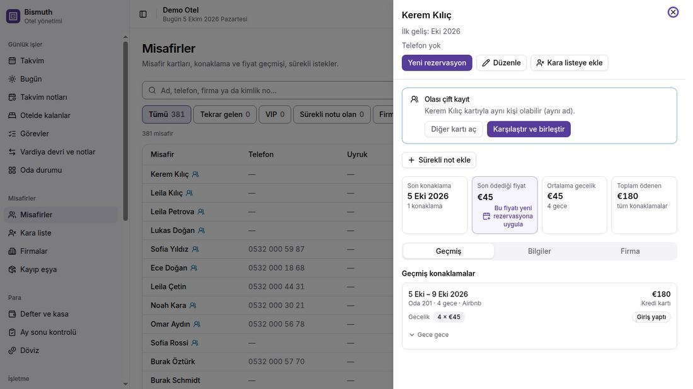

- **Geçmiş** sekmesi: gelecek rezervasyonlar ve geçmiş konaklamalar; her birinde oda, tarih, gecelik fiyat ve bakiye.
- **Bilgiler** sekmesi: telefon, e‑posta, konuştuğu dil, uyruk, notlar. Kimlik bilgisini yalnız yetkisi olan görür.
- **Firma** sekmesi: misafirin bağlı olduğu firma ve fatura bilgileri.
- **Yeni rezervasyon** düğmesi bu misafir için rezervasyon penceresini açar. **Bu fiyatı yeni rezervasyona uygula** son ödediği fiyatı öneri olarak getirir.

Bilgileri değiştirmek için **Düzenle**'ye basın. **VIP misafir** kutusunu işaretlerseniz listede ve takvimde taç simgesi çıkar.

### Etiketler

Misafirleri kendi gruplarınıza ayırmak için etiket kullanın ("Düzenli", "Firma misafiri", "Sessiz oda ister" gibi).

1. Etiketleri bir kez **Ayarlar → Listeler → Misafir etiketleri**'nde ekleyin. Kullanmadığınız etiketi silmek yerine kapatın.
2. Misafir kartında adın altındaki **Etiket ekle** (etiketi varsa **Etiketleri düzenle**) düğmesine basın ve kutuları işaretleyin. Her işaret hemen kaydedilir.
3. **Misafirler** listesinde etiketler adın altında görünür; arama kutusunun yanındaki **Tüm etiketler** seçimiyle listeyi tek bir etikete daraltın.

Rezervasyon panelindeki misafir özetinde de etiketler görünür. Kapatılmış bir etiket kartlarda soluk ve "(kapalı)" diye kalır, yeni misafire verilemez. Birleştirilen kartın etiketleri kalan karta taşınır.

### Yeni misafir

Misafir çoğu zaman rezervasyon yazarken eklenir. Rezervasyonsuz eklemek için **Yeni misafir**'e basın; yalnız **Ad** zorunludur. Program aynı ada ya da telefona sahip bir kayıt bulursa "Bu kişi zaten kayıtlı olabilir" der; **Kartı aç** ile eski kartı kullanın.

### Sürekli not

Misafirin her gelişinde hatırlanması gereken bir isteği varsa (yüksek kat, ekstra yastık, alerji):

1. Kartta **Sürekli not ekle**'ye basın.
2. **Her gelişinde hatırlanacak not**'u yazın.
3. **Önem**: **Bilgi** (panelde ve takvimde sarı kutu) ya da **Önemli** (rezervasyon kaydedilmeden önce okunduğu onaylatılır).
4. Kaydedin.

### Çift kayıtları birleştirmek

Aynı kişi iki kez yazılmışsa kartta **Olası çift kayıt** uyarısı çıkar.

1. **Karşılaştır ve birleştir**'e basın.
2. Kalacak kartı **Bu kart kalsın** ile seçin.
3. **Birleştir**'e basın.

Diğer kartın rezervasyonları, ödemeleri, notları ve firma bağlantısı kalan karta taşınır. Eski kart silinmez, "birleştirildi" olarak işaretlenir. Birleştirme geri alınamaz; emin değilseniz yapmayın.

### Firmalar ve fatura bilgileri

Fatura isteyen misafirlerin firma bilgilerini bir kez girin, her seferinde tek tıkla kopyalayın. Bismuth fatura kesmez; bilgileri fatura programınıza yapıştırırsınız.

1. **Misafirler** ekranında **Firmalar** sekmesini ya da menüdeki **Firmalar**'ı açın.
2. **Yeni firma**'ya basın: **Unvan**, **Adres**, **Şehir**, **Vergi dairesi**, **Vergi no**, **Telefon**, **E-posta**, **IBAN**, **Yetkili kişi**.
3. Sık kullanılan firmaları **Favori firma** yapın; listenin başında durur.
4. Misafiri firmaya bağlamak için misafir kartında **Firma** sekmesinde **Firma bağla**'ya basın ve firmayı seçin.

Kopyalamak için firmadaki kopyalama düğmesine basın. **Kopyalama biçimi**: **Alt alta** ya da **Tek satır**. Firmanın **Geçmiş ve misafirler** bölümünde bağlı misafirler ve konaklamaları görünür.

### Kara liste

İstenmeyen misafirler kara listeye eklenir; rezervasyon yazılırken ad ya da telefonla yakalanır.

Kontrol etmek için: **Misafirler → Kara liste**'yi açın, **Kontrol et** kutusuna ad soyad ya da telefon yazın. Yazdıkça karşılaştırılır; "Kara listede eşleşme yok" ya da eşleşen kişi görünür.

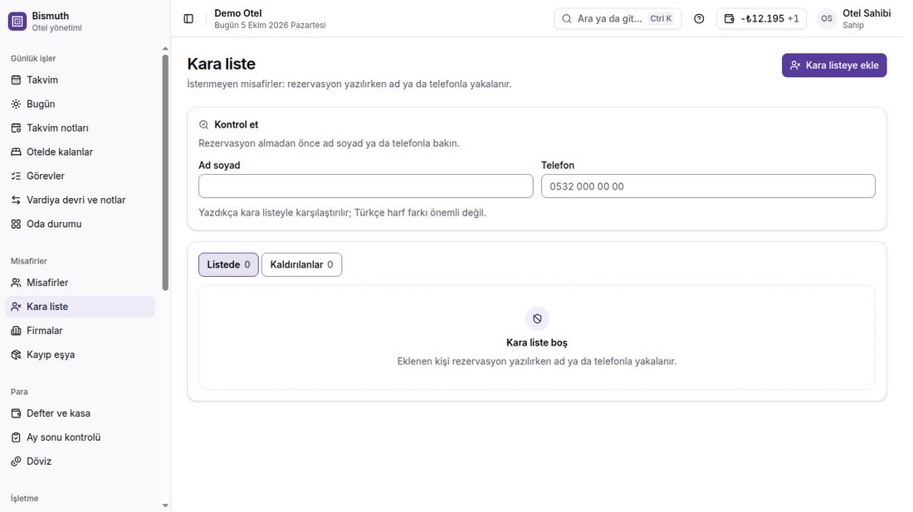

Eklemek için:

1. **Kara listeye ekle**'ye basın.
2. **Ad soyad** ve **Neden** zorunludur; varsa **Telefon** ve kimlik numarası.
3. **Ciddiyet**: **Uyar** (rezervasyonda kırmızı uyarı çıkar, onayla devam edilir) ya da **Engelle** (rezervasyonu yalnız sahip ya da müdür kaydedebilir).
4. **Neden türü** ve **Olay tarihi**'ni seçip kaydedin.

Misafir kartından da ekleyebilirsiniz; ad, telefon ve kimlik karttan gelir.

Listeden çıkarmak için satırda **Kaldır**'a basın, **Kaldırma nedeni**ni yazın (örneğin "borcunu ödedi") ve **Listeden kaldır**'ı seçin. Kayıt silinmez; **Kaldırılanlar** sekmesinde kimin ve neden kaldırdığıyla durur.

## 7. Otelde kalanlar ve KBS

Otelde kalan her kişinin Kimlik Bildirim Sistemi'ne (**KBS**) bildirilmesi yasal zorunluluktur. Bismuth KBS'ye bağlanmaz; KBS girişini her zamanki gibi KBS'de yaparsınız. Bismuth size **kimin bildirildiğini, kimin eksik olduğunu** gösterir ve gece vardiyasının herkesi tanımasına yardım eder.

### Ekranı açmak

Sol menüde **Günlük işler → Otelde kalanlar**'ı açın. Ekran şu an otelde kalanları oda oda gösterir: kişiler, tanıtıcı notlar, KBS durumu, çıkış tarihi ve bakiye.

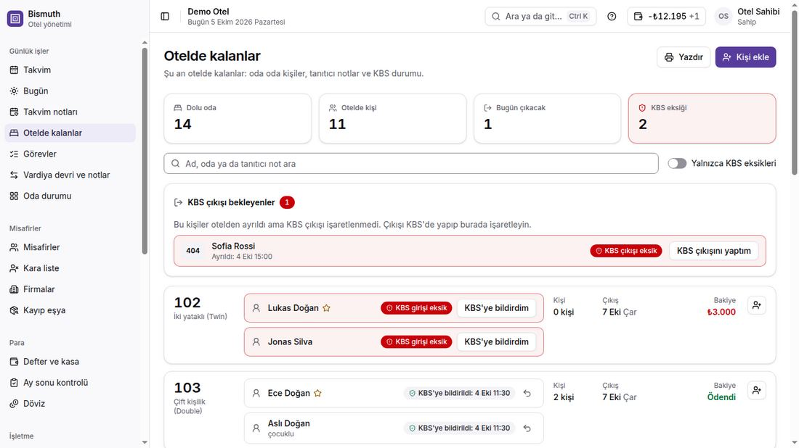

Üstteki kutular: **Dolu oda**, **Otelde kişi**, **Bugün çıkacak**, **KBS eksiği**.

- Arama kutusuna ad, oda ya da tanıtıcı not yazın (örneğin "gözlüklü").
- **Yalnız KBS eksikleri** anahtarını açınca yalnız bildirilmemiş kişiler kalır.

### KBS'ye bildirildi işareti

1. Kişiyi KBS'ye girin (her zamanki gibi).
2. Bismuth'ta o kişinin satırındaki **KBS'ye bildirdim** düğmesine basın.
3. Satırda "KBS'ye bildirildi" ile saat ve adınız görünür.

Yanlış işaretlediyseniz **İşareti geri al**'a basın. Bildirilmemiş kişi kırmızıyla görünür; Bugün ekranında ve takvimdeki çubukta da **KBS eksik** uyarısı çıkar.

> [!WARNING]
> Odada kimse yazılı değilse "Bu odada kimse kayıtlı değil" yazar. Odada kalanları ekleyip KBS'ye bildirin; boş oda KBS eksiği sayılır.

### Sonradan gelen kişi

Odaya sonradan biri katıldıysa:

1. **Kişi ekle**'ye basın (ya da odanın kendi kişi ekleme düğmesine).
2. **Oda**'yı seçin, **Ad soyad** yazın.
3. **Tanıtıcı not (isteğe bağlı)**: gece vardiyası isim sormadan tanısın diye kısa bir tarif ("kızıl saçlı, gözlüklü").
4. KBS'ye girdiyseniz KBS kutusunu işaretleyin ve kaydedin.

Kimlik numarası Bismuth'ta sorulmaz ve saklanmaz.

### Çıkışta KBS çıkışı

Misafir çıkarken KBS'den çıkışını da yapın. Rezervasyonda **Çıkış yap**'a bastığınızda açılan pencerede KBS çıkışı yapılan kişileri işaretlersiniz. İşaretlenmeyenler bu ekranın altındaki **KBS çıkışı bekleyenler** listesinde kalır: KBS'de çıkışı yapıp burada **KBS çıkışını yaptım**'a basın.

Kişi rezervasyon bitmeden ayrıldıysa rezervasyon panelinde **Kişiler** sekmesinden **Kişi işlemleri → Ayrıldı olarak işaretle**'yi seçin.

### Gece listesi

**Yazdır** düğmesi gece vardiyası için A4 bir liste basar: oda, kişiler ve tanıtıcı notlar, KBS durumu, giriş‑çıkış ve not. Ekran koyu temada olsa da liste beyaz kâğıda siyah basılır.

## 8. Oda durumu ve arıza

**Oda durumu** ekranı her odanın temizlik durumunu, odada kim kaldığını, bugünkü giriş‑çıkışı, arızaları ve satışa kapalı olup olmadığını tek bakışta gösterir. **Arızalar** ekranı ise odalardaki ve ortak alanlardaki sorunları fotoğrafıyla kaydeder.

### Oda durumları

Her odanın bir durumu vardır:

- **Temiz**: oda hazır, satılabilir.
- **Kirli**: temizlenmesi gerekiyor. Çıkış yapılınca oda **kendiliğinden** kirli olur.
- **Kontrol edildi**: temizlik kontrol edildi (isteğe bağlı bir adım).
- **Bakımda**: odada bakım var; oda takvimde satışa kapanır.
- **Kullanım dışı**: oda kullanılamaz; takvimde satışa kapanır.

### Kat planı

Sol menüde **Günlük işler → Oda durumu**'nu açın. Odalar kat kat kutular hâlinde görünür.

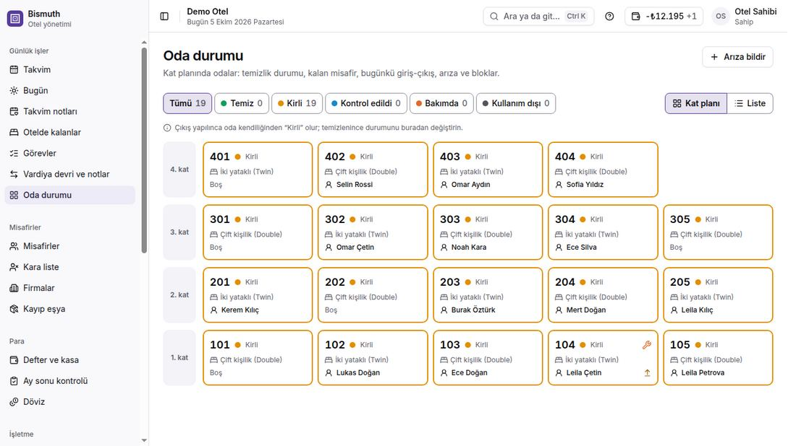

- Kutunun rengi ve yazısı durumu söyler; içinde odadaki misafir, **Bugün giriş**, **Bugün çıkış**, açık arıza sayısı ve **Satışa kapalı** bilgisi çıkar.
- Üstteki süzgeçle yalnız bir durumdaki odaları görün (örneğin yalnız kirliler).
- **Kat planı** ve **Liste** düğmeleri iki görünüm arasında geçer. Listede son değişikliği kimin yaptığı ve derin temizlik sayacı da yazar.

### Odayı temiz yapmak

Kat görevlisi odayı temizleyince (ya da WhatsApp'ta "302+" yazınca):

1. Odanın kutusundaki **Temizlendi** düğmesine basın.
2. "Oda 302 “Temiz” olarak işaretlendi" yazar.

Başka bir durum seçmek için odaya tıklayın; açılan pencerede **Durumu değiştir** altından durumu seçin. **Not** alanına kısa bir not yazabilirsiniz (örneğin "çarşaf eksik"); durum değişince not silinir.

> [!TIP]
> **Bakımda** ya da **Kullanım dışı** seçilen oda takvimde kendiliğinden satışa kapanır; başka bir durum seçince yeniden satılır. Oda bu gece doluysa kapatılamaz; misafir çıkınca durumu yeniden seçin.

### Arıza bildirmek

Odada ya da ortak alanda bir sorun görülünce (kırık klozet kapağı, akan musluk, yanmayan lamba):

1. Sol menüde **İşletme → Arızalar**'ı açın ve **Arıza bildir**'e basın.
2. **Nerede?**: **Oda** seçip odayı işaretleyin ya da **Genel alan** seçip yeri yazın (lobi, çatı, merdiven).
3. **Kısa başlık** yazın (örneğin "Tuvalet kapağı kırık") ve isterseniz **Açıklama**.
4. **Önem**: **Düşük**, **Orta** ya da **Acil**.
5. Oda kullanılamayacaksa **Odayı satışa kapat**'ı işaretleyin; arıza çözülene kadar oda takvimde kapalı görünür.
6. **Fotoğraflar**'a fotoğraf ekleyin (telefonla çekip ekleyebilirsiniz).
7. Kaydedin.

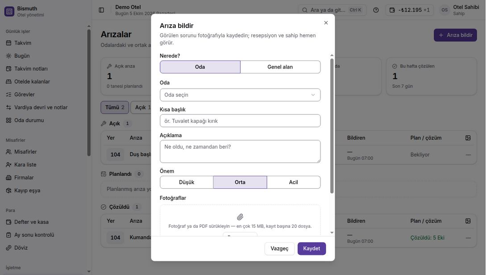

Arıza resepsiyon ve sahip tarafından hemen görülür: Bugün ekranında, takvimde oda numarasının yanındaki anahtar simgesinde ve kat planında.

### Arızayı planlamak ve kapatmak

**Arızalar** ekranında arızaya tıklayın:

- **Planla**: **Hangi gün?** ve **Kim yapacak?** (örneğin "tesisatçı") yazıp **Planı kaydet**'e basın. Arıza **Planlandı** olur.
- Onarım bitince **Çözüldü olarak kapat** altında **Çözüm notu** yazın (örneğin "conta değişti") ve **Çözüldü**'ye basın. Oda satışa kapatılmışsa yeniden açılır.
- Masraf olduysa deftere gider olarak yazın; arıza kaydında tutar tutulmaz.

Çözülmüş arızaların fotoğrafları belli bir süre sonra kendiliğinden silinir (arıza yazısı kalır); hemen silmek için **Fotoğrafları şimdi sil**.

Üstteki süzgeçle **Açık**, **Planlandı**, **Çözüldü** arızaları ayrı ayrı görebilirsiniz.

## 9. Kat görevlisi için

Bu bölüm kat görevlileri içindir. Bismuth'ta sizin işiniz kısadır: hangi odanın temizleneceğini görmek, temizlenen odayı işaretlemek, arıza bildirmek, size verilen görevleri yapıldı olarak işaretlemek ve bulduğunuz eşyayı bildirmek.

### Oturum açmak

1. Bilgisayarda ya da telefonda Bismuth'u açın.
2. Listeden adınıza tıklayın, PIN'inizi yazın ve <kbd>Enter</kbd>'a basın.
3. İşiniz bitince sağ üstteki adınıza basıp **Oturumu kapat**'ı seçin.

Telefondan nasıl bağlanacağınızı otel sahibi gösterir; bkz. [Uzaktan erişim](#remote).

### Bugün hangi odalar?

Oturum açınca **Bugün** ekranı gelir. **Kirli odalar** kutusu temizlenecek odaları gösterir; **Bugünkü görevler** size verilen işleri. Çıkış yapılan oda kendiliğinden kirli olur ve bu listeye düşer.

**Oda durumu** ekranında odalar kat kat görünür: hangisi kirli, hangisinde misafir var, hangisine bugün giriş yapılacak. Bugün giriş yapılacak kirli odaları önce temizleyin.

### Temizlenen odayı işaretlemek

1. **Oda durumu** ekranını açın.
2. Temizlediğiniz odanın kutusundaki **Temizlendi** düğmesine basın.

Oda **Temiz** olur; resepsiyon hemen görür. Odada bir eksik varsa odaya tıklayıp **Not** alanına yazın (örneğin "çarşaf eksik") ve **Notu kaydet**'e basın.

> [!TIP]
> WhatsApp grubuyla çalışmaya devam edebilirsiniz: "302+" yazarsanız resepsiyon odayı Bismuth'ta temiz yapar. Bismuth'ta kendiniz işaretlerseniz resepsiyonun işi azalır.

### Arıza bildirmek

Odada bozuk bir şey görürseniz:

1. **Arızalar** ekranını açın, **Arıza bildir**'e basın.
2. Odayı seçin, kısa bir başlık yazın (örneğin "Duş başlığı kırık").
3. **Önem**'i seçin; acilse **Acil**.
4. Telefonla fotoğraf çekip ekleyin.
5. Kaydedin.

Resepsiyon ve sahip arızayı hemen görür. Ayrıntılar: [Arıza bildirmek](#issues).

### Görevler

**Görevler** ekranında size ya da rolünüze verilen işler görünür (örneğin "kat depolarını kontrol et"). İşi bitirince görevin yanındaki kutuyu işaretleyin. Kimin ve ne zaman yaptığı kendiliğinden yazılır.

### Kayıp eşya

Odada unutulmuş bir eşya bulursanız resepsiyona verin ve haber verin; resepsiyon **Kayıp eşya** ekranına kaydeder. Bulan kişi olarak sizin adınız yazılır.

### Çalışma saatleriniz

Bugün ekranındaki **Çalışma saatlerim** kutusunda **Bugünün saatlerini gir**'e basın; geliş ve çıkış saatinizi yazıp kaydedin. Ek mesaiyi müdür onaylar.

## 10. Görevler ve bakım

**Görevler** ekranı otelin yapılacak işleridir: bugünküler, gecikenler ve yaklaşanlar. Tekrarlanan işler (her gün 12:00'de çıkış yapmayanları aramak, her ay klima filtresi) kendiliğinden görev olur. **Bakım** ekranı ise periyodik bakımları ve derin temizliği izler.

### Görev listesi

Sol menüde **Günlük işler → Görevler**'i açın.

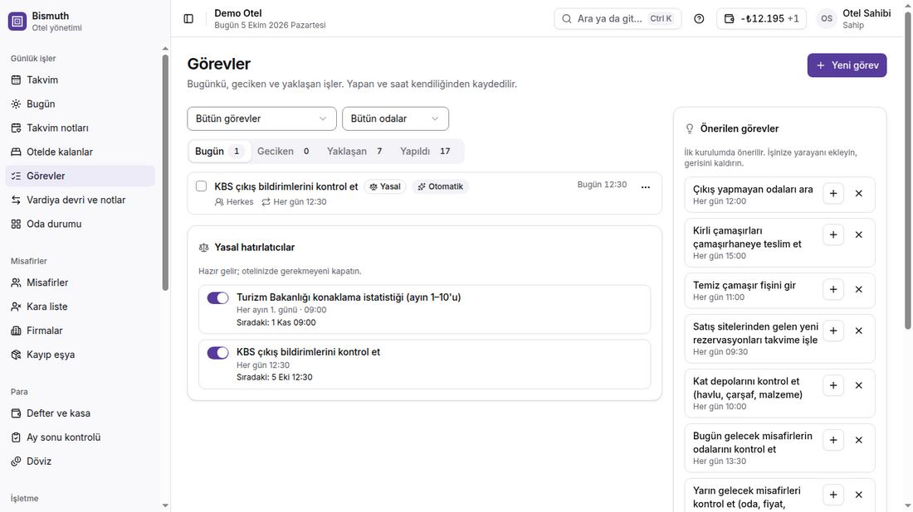

- Üstteki düğmeler listeyi seçer: **Bugün**, **Geciken**, **Açık**, **Yaklaşan**, **Yapıldı**.
- **Kime verilen** kutusu: **Bütün görevler** ya da **Bana verilenler**. **Oda** kutusuyla tek bir odanın görevlerini görürsünüz.
- Geciken görev kırmızı **Gecikti** yazısıyla görünür.
- "Yasal", "Bakım" ve "Otomatik" etiketleri görevin nereden geldiğini söyler.

### Görevi yapıldı olarak işaretlemek

Görevin başındaki kutuyu işaretleyin. "Görev yapıldı olarak işaretlendi" yazar; görevin altında **Yapan** ve saat görünür. Yanlışlıkla işaretlediyseniz kutuyu yeniden tıklayıp geri alın.

Bir görev artık gerekmiyorsa **Diğer işlemler → Görevi iptal et**'i seçin ve nedenini yazın. Görev silinmez, iptal edildi olarak kalır.

### Yeni görev

1. **Yeni görev**'e basın.
2. **Başlık** yazın (örneğin "302 klima filtresini temizle") ve isterseniz **Açıklama**.
3. **Kime**: bir **Kişi**, bir **Rol** (örneğin Temizlik) ya da bir **Vardiya** (örneğin Gece).
4. **Oda (isteğe bağlı)**: görev bir odayla ilgiliyse seçin.
5. **Tekrar**: **Tekrar yok**, **Her gün, belirli saatte**, **Haftanın belirli günleri**, **Ayın belirli günü** ya da **Her N konaklamada (oda bazında)**.
6. Tarih ve **Saat**'i seçip kaydedin.

"Her N konaklamada" seçilince sayım o odadan yapılan çıkışlarla ilerler; örneğin her 10 konaklamada bir derin temizlik.

### Önerilen görevler ve yasal hatırlatıcılar

Görevler ekranında **Önerilen görevler** kutusu ilk kurulumda gelir (örneğin "Çıkış yapmayan odaları ara", "Kat depolarını kontrol et (havlu, çarşaf, malzeme)", "Temiz çamaşır fişini gir"). İşinize yarayanı **Görevlere ekle** ile ekleyin, gerekmeyene **Gerek yok** deyin.

**Yasal hatırlatıcılar** otelin ülkesi Türkiye ise hazır gelir: Turizm Bakanlığı konaklama istatistiği (her ayın 1–10'u) ve KBS çıkış bildirimlerinin kontrolü. Gerekmeyeni anahtarından kapatın. Yangın tüpü, asansör gibi periyodik kontroller için **Bakım** ekranında hatırlatıcı ekleyin.

Düzenli işlerin tamamı **Ayarlar → Görev önerileri** bölümündedir; kendi düzenli görevinizi orada **Görev ekle** ile eklersiniz (her gün, her hafta, her ay, birkaç ayda bir, her yıl). Kapattığınız önerinin henüz yapılmamış görevleri iptal edilir.

### Bakım

Sol menüde **İşletme → Bakım**'ı açın. Burada su deposu temizliği, klima filtresi, yangın tüpü dolumu gibi **tekrarlanan bakımlar** durur. Zamanı yaklaşan bakım bir hafta önceden Görevler'e düşer.

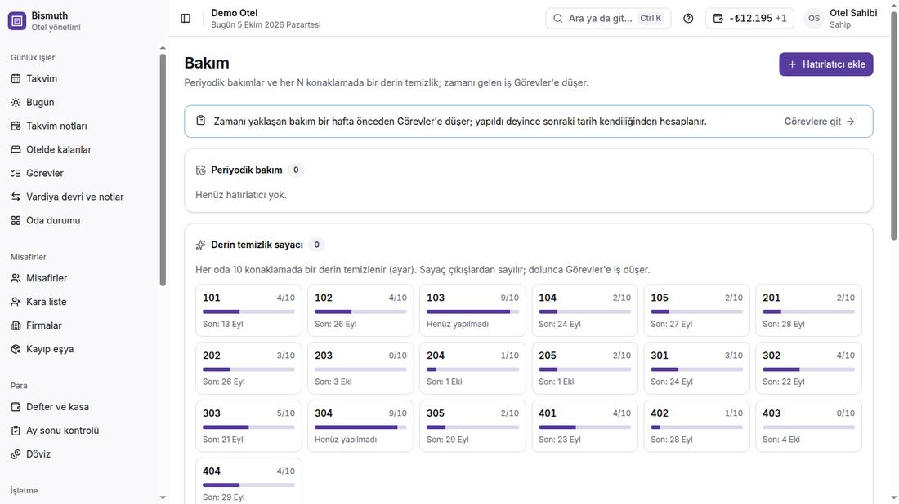

Hatırlatıcı eklemek için:

1. **Hatırlatıcı ekle**'ye basın.
2. **Ne yapılacak?** (örneğin "Klima filtreleri").
3. **Sıklık** ve **Birim**: örneğin 6 + **ayda bir**.
4. **İlk tarih** ve **Kaç gün önce uyarsın?**
5. **Firma / usta (rehberden)**: bakımı yapan firma rehberdeyse seçin; kendiniz yapıyorsanız **Kendimiz yapıyoruz**.
6. **Sorumlu (isteğe bağlı)** seçip kaydedin.

Bakım yapılınca satırdaki **Yapıldı**'ya basın, **Yapıldığı gün**'ü ve isterseniz not yazın (firma, fiş no). Bir sonraki tarih kendiliğinden hesaplanır. **Örnek bakım hatırlatıcıları** kutusundan hazır önerileri de ekleyebilirsiniz.

### Derin temizlik sayacı

Her oda belli sayıda konaklamada bir derin temizlenir (örneğin her 10 konaklamada bir). **Derin temizlik sayacı** her odanın kaç konaklama yaptığını gösterir; sayaç dolunca Görevler'e iş düşer. Derin temizlik yapılınca Bakım ekranındaki sayaçta o odanın **Temizlendi** düğmesine basın; sayaç sıfırlanır.

Kaç konaklamada bir yapılacağı **Ayarlar → Görev önerileri** bölümünden değişir.

## 11. Vardiya devri ve notlar

Vardiya değişirken giden kişi gelen kişiye neyin beklediğini söyler. Bismuth bunun büyük kısmını kendiliğinden hazırlar: henüz gelmemiş girişler, bu gece kalanlar, KBS eksikleri, ödenmemiş bakiyeler, açık görevler ve arızalar, kasadaki nakit. Siz yalnız eklemek istediğinizi yazarsınız.

Sol menüde **Günlük işler → Vardiya devri ve notlar**'ı açın. Ekranın üç sekmesi vardır: **Devir**, **Notlarım**, **Pano**.

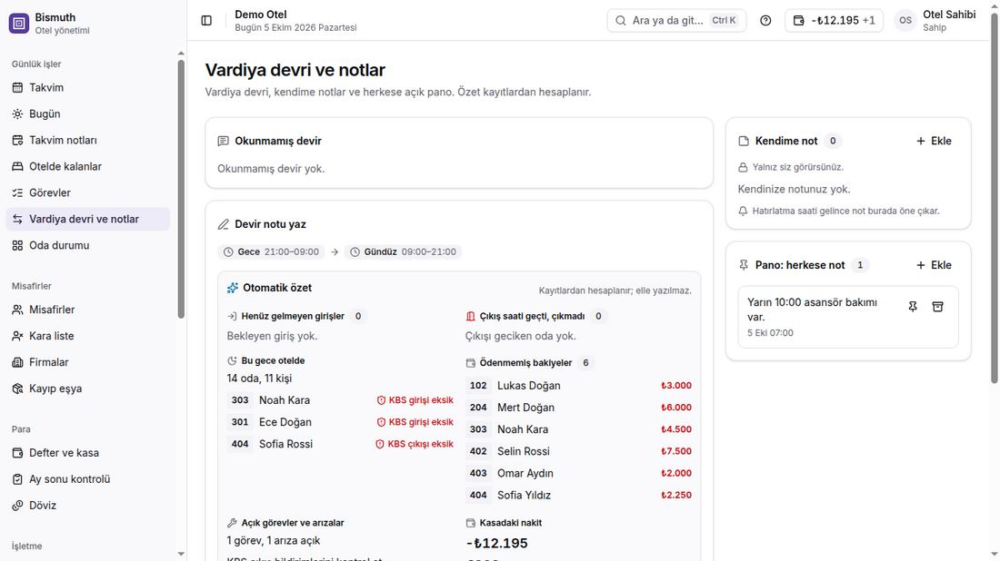

### Devir yazmak (vardiya biterken)

1. **Devir** sekmesinde **Otomatik özet**'e bakın: **Henüz gelmeyen girişler**, **Bu gece otelde**, **KBS eksikleri**, **Ödenmemiş bakiyeler**, **Açık görevler ve arızalar**, **Kasadaki nakit**, **Çıkış saati geçti, çıkmadı**. Bunlar kayıtlardan hesaplanır; elle yazılmaz.
2. **Devir notu yaz** bölümündeki **Devir notu** alanına özete eklemek istediklerinizi yazın. Örneğin: "503 geç gelecek, kapıyı açık bırakın", "102'nin klima kumandası resepsiyonda".
3. **Devri kaydet**'e basın.

Devir kaydedildiği andaki özetle birlikte saklanır; sonradan değişen rakamlar eski devri bozmaz.

> [!TIP]
> Söyleyecek özel bir şey yoksa notu boş bırakıp yine **Devri kaydet**'e basın; gelen kişi otomatik özeti okur.

### Devri okumak (vardiyaya başlarken)

Okunmamış bir devir varsa Bugün ekranında **Okunmamış vardiya devri** uyarısı çıkar.

1. **Devri oku**'ya basın ya da **Vardiya devri ve notlar** ekranını açın.
2. **Okunmamış devir** kutusunda notu ve **Devir anındaki özet**'i okuyun.
3. **Okudum**'a basın.

Kim yazdı, kim ve ne zaman okudu kayıtta kalır. Kendi yazdığınız devri okundu işaretleyemezsiniz. Son 14 günün devirleri **Geçmiş devirler** altında durur.

Vardiya saatleri **Ayarlar → Vardiyalar** bölümünde tanımlıdır (örneğin Gündüz 09:00–21:00, Gece 21:00–09:00).

### Kendime not

**Notlarım** sekmesi yalnız sizin içindir; başkası göremez.

1. **Kendime not ekle**'ye basın, notu yazın.
2. İsterseniz **Hatırlat**'ı açıp gün ve **Saat** seçin. Zamanı gelince not öne çıkar.
3. İş bitince **Notu kapat**.

### Pano

**Pano** sekmesi bütün çalışanların gördüğü duyuru tahtasıdır (örneğin "Cumartesi su kesintisi var").

1. **Panoya not yaz**'a basın, notu yazın.
2. Önemliyse **Üste sabitle**'yi işaretleyin; sabit notlar en üstte durur.
3. Not eskiyince **Panodan kaldır**.

## 12. Personel ve maaş

**Personel** ekranında çalışan kartları, aylık maaş tablosu, avans, izin, mesai ve 14 günlük çizelge durur. Maaş ve avans ödemeleri deftere kendiliğinden gider olarak yazılır. Bu ekranı sahip ve muhasebe görür; müdür izin ve ek mesaiyi yönetir.

Sol menüde **Personel → Personel**'i açın. Dört sekme vardır: **Çalışanlar**, **Maaş tablosu**, **İzin ve çizelge**, **Mesai**.

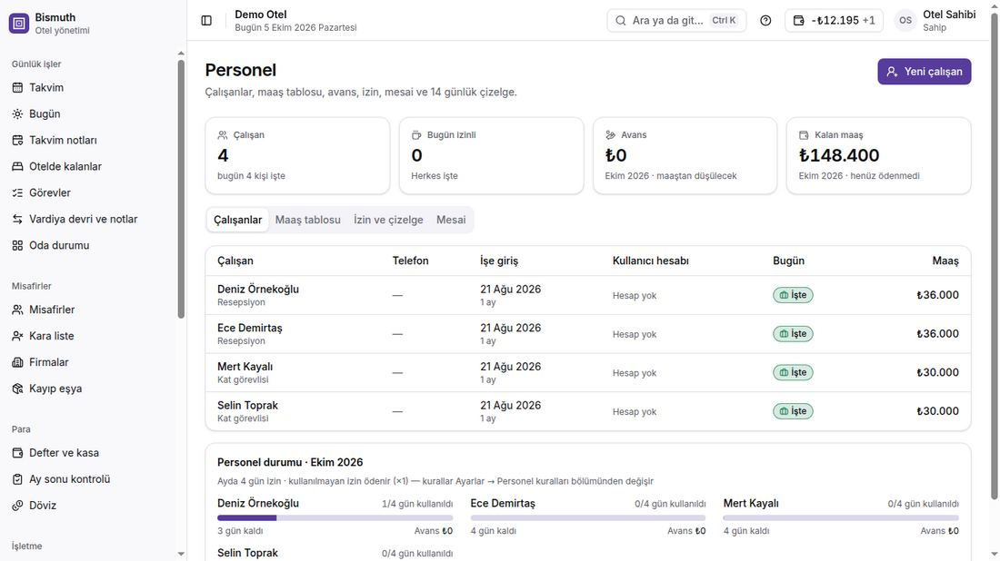

Üstteki kutular: çalışan sayısı ve bugün işte olanlar, **Bugün izinli**, bu ayın **Avans** toplamı, **Kalan maaş**, **Bu ay kullanılan izin**.

### Yeni çalışan

1. **Yeni çalışan**'a basın.
2. **Ad**, **Soyad**, **Görev** (örneğin resepsiyon), **Telefon**, **İşe giriş** tarihi ve **Aylık maaş**'ı yazın.
3. Çalışanın programa girecek bir hesabı varsa **Kullanıcı hesabı** kutusundan bağlayın. Hesaplar **Ayarlar → Kullanıcılar ve roller** bölümünden açılır.
4. Kaydedin.

Bir çalışana tıklayınca kartı açılır: bu ayın özeti, hareketleri, maaş geçmişi ve düğmeler.

### Maaşı değiştirmek

Kartta **Maaşı değiştir**'e basın; yeni tutarı ve **Geçerli olduğu tarih**'i yazın. O tarihten sonraki aylar yeni maaşla hesaplanır; önceki aylar değişmez. Eski maaşlar **Maaş geçmişi**'nde kalır.

### Avans vermek

1. Kartta ya da maaş tablosunda **Avans ver**'e basın.
2. **Avans tutarı**'nı yazın; bu ay kalan maaş üstte görünür.
3. Para resepsiyon kasasından verildiyse **Kasadan verildi**'yi işaretleyin; kasadaki nakitten düşer.
4. Kaydedin.

Avans deftere gider olarak yazılır ve bu ayın maaşından düşer. Kasadan avans verilip verilemeyeceği bir ayardır (**Ayarlar → Personel kuralları**).

### Maaş tablosu ve maaş ödemek

**Maaş tablosu** sekmesi seçilen ay için her çalışanın satırını gösterir: **Maaş**, **Avans**, **İzin parası**, **Ek mesai**, **Prim**, **Kesinti**, **Net ödenecek**, **Ödenen**, **Kalan**. Oklarla önceki ya da sonraki aya geçin.

Maaş ödemek için:

1. Satırdaki **Maaş öde**'ye basın.
2. **Ödenen tutar**'ı ve **Ödeme yöntemi**ni seçin. Maaş parça parça da ödenebilir.
3. **Ödemeyi kaydet**'e basın.

Ödeme deftere maaş gideri olarak yazılır. Prim ya da kesinti (örneğin "kırılan bardak") için **Prim ya da kesinti**'yi kullanın; bu, deftere gider yazmadan net tutarı değiştirir.

Ay tamamen ödenince **Ayı kilitle** ile o ayı kilitleyin. Kilitli ayda maaş, avans ve izin kayıtları değiştirilemez; gerekirse yetkili kişi **Kilidi aç** ile nedenini yazarak açar.

> [!TIP]
> Yanlış bir avans ya da ödeme, kartın **Bu ayın hareketleri** listesinden iptal edilir; defterdeki gideriyle birlikte iptal olur. Kayıt silinmez.

### İzin

1. **İzin ve çizelge** sekmesinde **İzin kaydet**'e basın.
2. Çalışanı, **Tür**'ü seçin: **İzin günü** (aylık izin hakkından düşer), **Yıllık izin**, **Hastalık**, **Ücretsiz** ya da **Bayramda çalıştı**.
3. **Başlangıç** gününü ve **Gün** sayısını yazın; bu ay kaç gün kullanıldığı ve kaç gün kalacağı altında yazar.
4. Kaydedin.

**14 günlük çizelge** herkesin önümüzdeki iki haftasını renklerle gösterir: Gündüz, Gece, İzin günü, Yıllık izin, Hastalık. Aylık izin günü, kullanılmayan iznin ödenip ödenmeyeceği ve devredip devretmeyeceği **Ayarlar → Personel kuralları**'ndadır.

### Mesai ve ek mesai

Çalışanlar geliş ve çıkış saatlerini kendileri girer (Bugün ekranındaki **Çalışma saatlerim** kutusundan). **Mesai** sekmesinde müdür ya da sahip:

- Her çalışanın gün gün **Geliş–çıkış** saatlerini ve **Çalışılan** süreyi görür, gerekirse düzeltir.
- Günlük çalışma saatini aşan süre **Önerilen ek mesai** olarak çıkar; **onayla** ile onaylanır.
- Bir günü **Bayram** olarak işaretler.

Ek mesai ücreti otelin kuralına göre hesaplanır (ödenmez, sabit saat ücreti ya da saat ücretinin katı).

### Ücret kuralları

Otelin genel kuralları **Ayarlar → Personel kuralları** bölümündedir: aylık izin günü, kullanılmayan iznin ödenmesi ve katsayısı, günlük ücret hesabı (ayın gün sayısına ya da sabit bir sayıya bölünür), günlük çalışma saati, ek mesai ücreti, bayram çalışması katsayısı, prim ve kasadan avans.

Tek bir çalışana özel kural gerekiyorsa çalışanın kartında **Ödeme kuralları**'nı açın; açtığınız kural yalnız o çalışana uygulanır.

### İşten ayrılan çalışan

Kartta **İşten ayrıldı olarak işaretle**'yi seçin, **Son çalıştığı gün**'ü girin ve pencerede yine **İşten ayrıldı olarak işaretle**'ye basın. Kart silinmez; geçmiş maaş ve izin kayıtları korunur. Son ayın maaşı çalıştığı günlere göre hesaplanır. Ayrılanları listede görmek için **Ayrılanları göster**.

## 13. Rehber, tedarik, çamaşırhane, kayıp eşya

Bu bölüm otelin işletme ekranlarını anlatır: sık aranan numaralar (**Rehber**), ürün alımları ve fiyatlar (**Tedarik**), çamaşırhane teslimleri (**Çamaşırhane**) ve bulunan eşyalar (**Kayıp eşya**).

### Rehber

Sol menüde **İşletme → Rehber**'i açın. Tedarikçi, çamaşırhane, tesisatçı, elektrikçi, taksi ve acil numaralar burada durur.

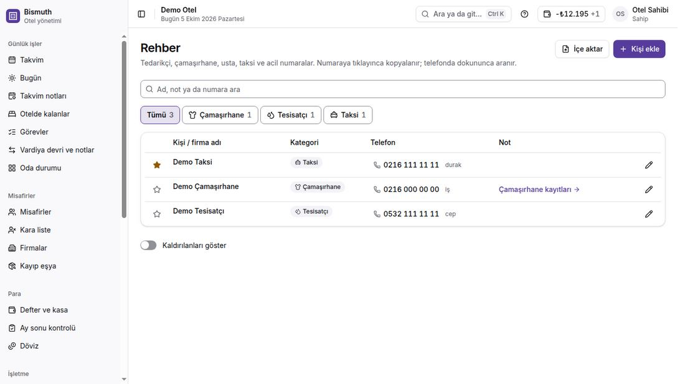

- Bir numaraya **tıklayınca kopyalanır**; telefonda dokununca aranır.
- Üstteki kategori düğmeleriyle (Tedarikçi, Çamaşırhane, Tesisatçı…) listeyi daraltın; arama kutusuna ad, not ya da numara yazın.
- Yıldızla **favori** yaptığınız kişiler listenin başında ve Bugün ekranındaki **Sık aranan numaralar** kutusunda durur.

Kişi eklemek için **Kişi ekle**'ye basın: **Kişi / firma adı**, **Kategori** (listede yoksa **Kendi kategoriniz…**), **Görüşülen kişi**, **Telefon numaraları** (birden çok numara ve etiket: cep, iş…), **E-posta**, **Adres**, **Not** (örneğin "Salı ve cuma teslim").

Excel'deki rehberinizi topluca almak için **İçe aktar**'a basın; satırları yapıştırın ya da CSV dosyası açın. Her satırda: ad; telefon; kategori.

Hızlı aramada (<kbd>Ctrl</kbd> + <kbd>K</kbd>) "rehber" yazıp bir ad yazarsanız numara doğrudan çıkar.

### Tedarik

**İşletme → Tedarik** ekranı aldığınız ürünleri, son alış fiyatlarını ve zamları izler. Üç sekme vardır: **Ürünler**, **Alımlar**, **Aylık özet**.

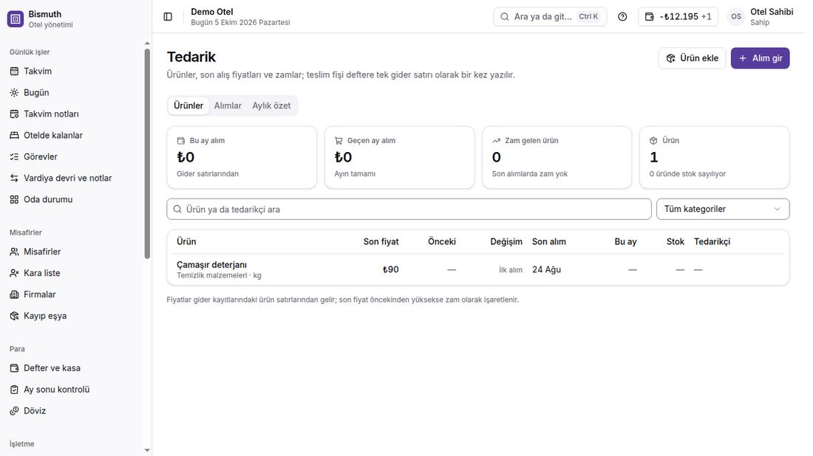

Önce ürünleri ekleyin: **Ürün ekle** → **Ürün adı** (örneğin "Munzur 0,5 L"), **Birim** (adet, kg, lt, paket, çuval), **Kategori**, tedarikçi (rehberden). Fiyat burada yazılmaz; alımlardan gelir.

Bir teslim fişi geldiğinde:

1. **Alım gir**'e basın.
2. Tedarikçiyi, **Ödeme yöntemi**ni ve **Gider bölümü**nü seçin.
3. **Ürünler** altında her satıra ürünü, miktarı ve birim fiyatı yazın; **Ürün ekle** ile satır ekleyin. Listede olmayan ürünü **Listede olmayan ürün ekle** ile ekleyin.
4. Fişin toplamı farklıysa (taşıma, depozito) **Gider toplamı**'nı düzeltin.
5. Para kasadan çıktıysa **Kasadan ödendi**'yi işaretleyin; isterseniz fiş fotoğrafı ekleyin.
6. Kaydedin.

Alım deftere **tek gider satırı** olarak bir kez yazılır; ürünlerin fiyat geçmişi güncellenir. Son fiyat öncekinden yüksekse ürün **zam** olarak işaretlenir (örneğin "+%12 zam"). Bir ürüne tıklayınca fiyat geçmişi grafikte ve tabloda görünür.

### Çamaşırhane

**İşletme → Çamaşırhane** ekranı kirli giden ve temiz gelen çamaşırı tür tür sayar; eksik ve lekeli parçaları gösterir; ay sonunda faturayı fişlerle karşılaştırır.

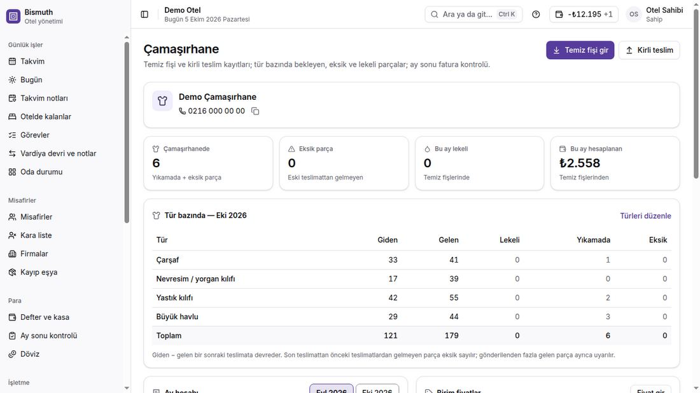

Önce çamaşırhaneyi **Rehber**'e **Çamaşırhane** kategorisiyle ekleyin; ekranda çamaşırhaneyi seçin. Çamaşır türleri (çarşaf, nevresim, havlu…) **Ayarlar → Listeler → Çamaşır türleri**'ndedir.

- Kirli çamaşır giderken **Kirli teslim**'e basın; her türün adedini yazıp kaydedin.
- Temiz çamaşır gelince **Temiz fişi gir**'e basın; fişteki sırayla her türün adedini ve **Lekeli** adedini yazın. <kbd>Enter</kbd> sonraki kutuya geçer, sonuncuda kaydeder. İsterseniz **Fiş no** ve fiş fotoğrafı ekleyin.

Tür bazında tablo **Giden**, **Gelen**, **Yıkamada** ve **Eksik** parçaları gösterir. Önceki teslimattan gelmeyen parça **eksik** sayılır; gönderilenden fazla gelen parça ayrıca uyarılır.

Ay sonu:

1. **Birim fiyatlar** kartında anlaştığınız fiyatları **Fiyat gir** ile girin (zam olunca yeni fiyatı geçerli tarihiyle girin; eski fişler eski fiyatla kalır).
2. **Ay hesabı** fişlerden hesaplanan tutarı gösterir. Çamaşırhanenin faturası gelince **Fatura gir** ile tutarı yazın; fark varsa program söyler.
3. Faturayı ödeyince **Ödendi**'ye basın; fatura ayın son gününe defterde tek gider satırı olur.

Yanlış teslim kaydı **Teslim defteri**'nden **İptal et** ile iptal edilir.

### Kayıp eşya

Misafirin unuttuğu eşyalar **Misafirler → Kayıp eşya** ekranında tutulur.

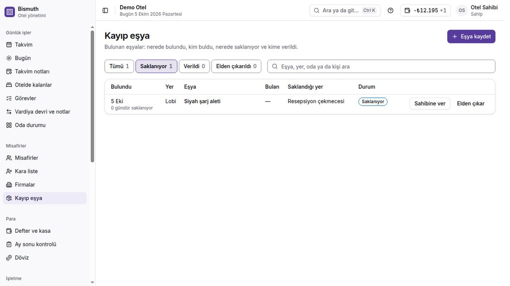

1. **Eşya kaydet**'e basın.
2. **Eşya** (örneğin "siyah şarj aleti"), **Bulunduğu gün**, **Bulan** kişi.
3. **Nerede bulundu**: **Odada** (odayı seçin) ya da **Ortak alanda** (yeri yazın).
4. **Saklandığı yer** (örneğin "resepsiyon, çekmece 2").
5. İsterseniz **Olası sahibi**, fotoğraf ve not; kaydedin.

Eşya sahibine verilince **Sahibine ver**'e basın; **Kime verildi**'yi ve günü yazın. Uzun süre sahibi çıkmazsa **Elden çıkar** ile nedenini yazarak kapatın. Kayıt silinmez; yanlışlıkla değiştirdiyseniz **Geri al** ile yeniden "Saklanıyor" yapın. Üstteki süzgeç **Saklanıyor**, **Verildi**, **Elden çıkarıldı** eşyaları ayırır.

## 14. Döviz, hava, özel günler

**Döviz** ekranında güncel kurlar, otelin kendi kuru, çevirici, hava durumu ve bayram tarihleri durur. **Takvim notları** ekranında ise bayramlar, özel günler ve kendi notlarınız yıl yıl listelenir.

### Kurlar

Sol menüde **Para → Döviz**'i açın. Üç sekme vardır: **Döviz**, **Hava durumu**, **Bayramlar**.

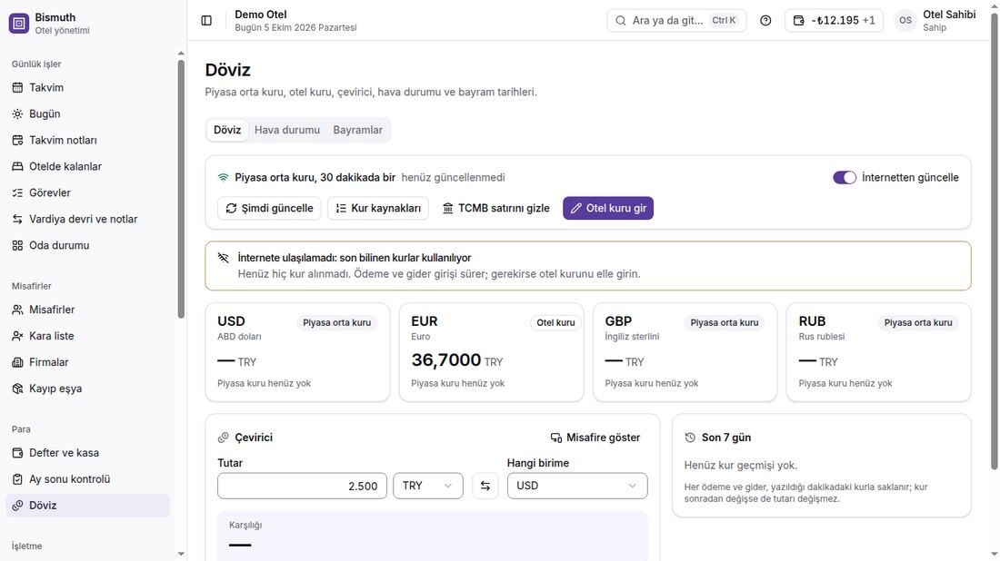

- Her döviz için bir kart: güncel kur, düne göre değişim, son 7 günün en düşük ve en yüksek değeri. Kaynağı **Piyasa orta kuru** ya da **Otel kuru** olarak yazar.
- İnternet varken kurlar belli aralıklarla kendiliğinden yenilenir. Hemen yenilemek için **Şimdi güncelle**.
- **İnternetten güncelle** anahtarı kapatılırsa program internete hiç çıkmaz; son bilinen kurlar kullanılır. Ödeme ve gider girişi aynen sürer.
- **TCMB** satırı yalnız karşılaştırma içindir; **TCMB satırını gizle** ile kaldırılabilir.

Her ödeme ve gider, yazıldığı dakikadaki kurla saklanır; kur sonradan değişse de tutarı değişmez.

### Otel kuru

Otel misafire kendi sabit kurunu söylüyorsa (örneğin "1 € = ₺50"):

1. Dövizin kartında **Otel kuru gir**'e basın.
2. **1 EUR kaç TRY** alanına kuru yazın (örneğin 50).
3. Kaydedin.

**Misafire bu kurdan söyle** açıkken çevirici, misafir ekranı ve yeni ödeme ve gider kayıtları otel kurunu kullanır. Piyasa kuruna dönmek için **Piyasa kuruna dön**. Yeni kur yalnız bundan sonraki kayıtlara uygulanır.

### Çevirici

**Çevirici** kutusunda tutarı ve para birimini yazın; **Hangi birime** seçin. Karşılığı ve diğer birimlerdeki tutarlar hemen çıkar. **Misafire göster** sonucu misafire gösterebileceğiniz biçimde açar. **Yuvarlama**: **Kuruşuna kadar**, **Tam sayıya** ya da **10'un katına**.

### Kur kaynakları

**Kur kaynakları** penceresinde programın kuru hangi kaynaklardan hangi sırayla aldığı ve her birinin durumu yazar (**Çalışıyor**, **Bu sefer ulaşılamadı**, **24 saat dinleniyor**). Bazı kaynaklar kendi ücretsiz API anahtarınızla çalışır; anahtarı buraya girersiniz. Çoğu otel için varsayılan ayar yeterlidir.

### Hava durumu

**Hava durumu** sekmesi otelin şehri için saatlik ve haftalık tahmini gösterir; Bugün ekranında da küçük bir kutusu vardır. Konum yanlışsa **Konumu değiştir**'e basıp listeden şehir ya da ilçe seçin. Hava durumunu istemiyorsanız sekmedeki anahtarla kapatın.

### Özel günler ve takvim notları

Sol menüde **Günlük işler → Takvim notları**'nı açın. Resmî tatiller ve bayramlar her yıl için **kendiliğinden** eklenir; siz fuar, kongre, düğün gibi özel günleri ve notları eklersiniz. Bu günler takvimin başlığında ve Bugün ekranında görünür; özel günlerde rezervasyonda oda tipinin hafta sonu fiyatı önerilir. Hafta sonu fiyatının hangi gecelere uygulanacağı ayrıca **Ayarlar → Takvim → Hafta sonu fiyatı uygulanan geceler**'de seçilir (varsayılan cuma ve cumartesi geceleri); takvimdeki vurgulu günlerden bağımsızdır.

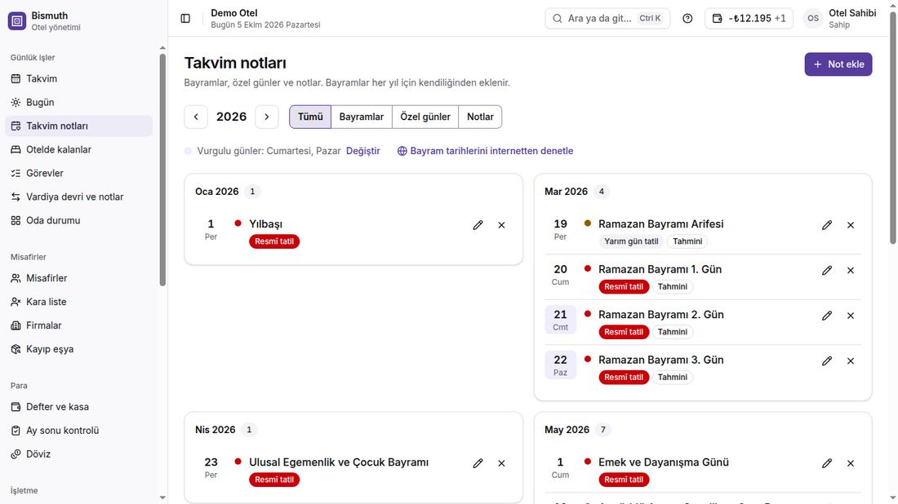

Not eklemek için:

1. **Not ekle**'ye basın.
2. **Başlık** (örneğin "Fuar") ve **Tür**: **Resmî tatil**, **Yarım gün tatil**, **Özel gün**, **Etkinlik** ya da **Not**.
3. **Hangi günler**: **Tek gün**, **Tarih aralığı**, **Haftanın günleri** ya da **Tarih listesi**.
4. Her yıl tekrarlanacaksa **Her yıl tekrarla**'yı işaretleyin; isterseniz renk seçin.
5. Kaydedin.

Bir günü düzeltmek ya da iptal etmek için satırdaki düğmeleri kullanın; kayıt silinmez. Yıl değiştirmek için oklar, türe göre süzmek için üstteki düğmeler (**Bayramlar**, **Özel günler**, **Notlar**) vardır. Takvimde vurgulanan günler (örneğin cumartesi ve pazar) burada **Değiştir** ile ayarlanır.

> [!TIP]
> Dini bayramların tarihi hesapla bulunur ve açıklanan tarihten bir gün farklı olabilir ("Tahmini" yazar). **Bayram tarihlerini internetten denetle**'ye ya da Döviz ekranının **Bayramlar** sekmesinde **Şimdi denetle**'ye basın; program açıklanan tarihleri okuyup kendi eklediği günleri düzeltir, sizin değiştirdiğiniz günlere dokunmaz.

## 15. Ay sonu kontrolü ve raporlar

Ay bitince otel sahibi bir kontrol yapar: kart ve IBAN toplamları, maaşlar, ciro ve kâr, en çok neye harcandığı ve bakanlık bildirimi. **Ay sonu kontrolü** ekranı bunların hepsini tek yerde toplar; **Raporlar** ekranı ise dönem dönem grafikler ve karşılaştırmalar verir. Rakamların hepsi girdiğiniz rezervasyon, ödeme ve giderlerden kendiliğinden hesaplanır; hiçbir şey ikinci kez yazılmaz.

### Ay sonu kontrolü

Sol menüde **Para → Ay sonu kontrolü**'nü açın. Ayı üstteki kutudan seçin ya da oklarla önceki veya sonraki aya geçin. Sağ üstte **Excel'e aktar** ve **Yazdır / PDF** düğmeleri vardır.

En üstte **Ciro**, **Gider**, **Kâr** ve **Doluluk** kutuları önceki aya göre değişimle görünür.

**Kontrol listesi** beş adımdan oluşur:

1. **Kredi kartı ve IBAN toplamları**: bankada kontrol bekleyen tutar. Kart ve IBAN satırlarını banka ekstresiyle karşılaştırıp defterde teslim alındı (x) yapın. Bkz. [Parayı teslim almak](#handover).
2. **Maaşlar**: ödenecek kalan tutar. Bkz. [Personel ve maaş](#salary-table).
3. **Ciro, gider ve kâr**: ayın kârı.
4. **En çok ne harcandı**: en büyük gider kalemi.
5. **Turizm Bakanlığı bildirimi**: son gün ve kalan gün sayısı; **Aç** ile Turizm istatistiği ekranına gidersiniz. Bkz. [Bakanlık istatistiği](#tourism).

1, 2 ve 5. adımlar kayıtlardan kendiliğinden işaretlenir (yeşil). 3. ve 4. adımı baktıktan sonra siz işaretlersiniz; bu işaretler hesabınıza kaydedilir ve her bilgisayarda aynı görünür. Başka bir kullanıcı sizin işaretlerinizi görmez.

Altındaki kutular:

- **Ödeme yöntemleri**: her yöntemin **Toplam**, **Teslim alındı (x)** ve **Bekleyen** tutarı; altında IBAN'a gelenler kanala göre (banka ekstresiyle karşılaştırmak için). Nakit yalnız bilgi için gösterilir.
- **Turizm istatistiği**: ayın bildirim tarihleri; **Tabloyu hazırla** ile bakanlık tablosuna geçersiniz.
- **En çok harcama**: personel, ürün grupları ve gider açıklamalarına göre en büyük kalemler. Aynı gider farklı yazılmışsa defterdeki **Açıklama sözlüğü** ile birleştirin.
- **Maaşlar**: her çalışan için maaş, avans, izin, izin parası, net ödenecek, ödenen ve kalan.
- **Kur kaynakları**: dövizli kayıtların ana para birimi karşılığının hangi kurla sabitlendiği (aşağıya bakın).

Her tablonun köşesindeki indirme düğmesi yalnız o tabloyu dosya olarak kaydeder.

### Raporlar

Sol menüde **Raporlar → Raporlar**'ı açın.

- **Dönem**: **Bu ay**, **Geçen ay**, **Bu yıl** ya da **Tarih aralığı**. **Karşılaştır**: **Önceki dönem**, **Geçen yıl aynı dönem** ya da **Karşılaştırma yok**. Seçilen tarihler kutuların altında yazar.
- Sekmeler: **Özet**, **Yıllık özet**, **Doluluk ve göstergeler**, **Kasa ve ödemeler**, **Giderler**, **Personel**.
- **Özet**: **Ciro**, **Kâr**, **Gider** ve **Doluluk** kutuları; **Günlük ciro** grafiği (bir güne basınca o günün dökümü açılır), **Gelir detayları**, **Satış kanalları**, **Gider bölümleri**, **En çok harcama**, **Tedarik giderleri** ve **Kur kaynakları**.
- **Doluluk ve göstergeler**: aylara, haftanın günlerine, oda tipine ve odaya göre doluluk; **Ortalama gecelik fiyat** (oda geliri ÷ satılan gece), **Oda başına gelir** (oda geliri ÷ satılabilir gece), **Ortalama konaklama süresi** ve **Tekrar gelen misafir**.
- **Kasa ve ödemeler**: ödeme yöntemine göre tutarlar, teslim alınmamış para, kontrol bekleyen nakit dışı satırlar ve teslim alma geçmişi.
- **Giderler** ve **Personel**: aylara göre gider, gider dağılımı ve personel maliyeti.
- Grafiklerin **Grafik** ve **Tablo** görünümü vardır; tabloda rakamları satır satır okursunuz.
- **Excel'e aktar** bütün raporu tek bir Excel dosyası olarak kaydeder; her tablonun indirme düğmesi yalnız o tabloyu Excel ya da CSV olarak verir. **Yazdır / PDF** raporu kâğıda ya da PDF'e basar.
- **Tedarik giderleri** kutusu dönemin ürünlü alımlarını ürün kategorisine göre gösterir; alımlar **Tedarik** ekranından girilir.
- **Kur kaynakları** kutusu dövizli kayıtların karşılığının hangi kurla sabitlendiğini söyler: **Piyasa orta kuru** (kaynağın adıyla), **TCMB kuru**, **Otel kuru**, **Elle girilen kur** ya da **Kur yok (toplamlara katılmadı)**. Kuru olmayan kayıtlar toplamlara katılmaz; o günün kurunu **Döviz** ekranından girince eklenir.

Doluluk hesaplanırken satışa kapalı günler satılabilir gecelerden düşülür.

Para raporlarını (ciro, kâr, gider) yalnız yetkisi olan görür. Resepsiyon rolü doluluk ve oda‑gece bilgilerini görür, para rakamlarını görmez. **Sahip giderleri** bölümünü yalnız o bölümü görme yetkisi olan görür.

## 16. Bakanlık (turizm) istatistiği

Her ayın 1'i ile 10'u arasında, bir önceki ayın konaklama istatistiği Kültür ve Turizm Bakanlığı'nın paneline girilir: ülke ülke **Toplam Giriş** ve **Toplam Geceleme**. Bismuth bu tabloyu KBS'den indirdiğiniz Excel dosyasından saniyeler içinde hazırlar.

### Hazırlık: KBS listesini indirmek

1. Ay bittikten sonra KBS'ye girin.
2. Geçen ayın **"EGM Konaklayan Listesi"** Excel dosyasını indirin (adı "EGM_Konaklayan_Listesi_…xlsx" gibidir).
3. Dosyayı bilgisayarda bulabileceğiniz bir yere kaydedin.

Bismuth dosyadaki ad, kimlik numarası ve cinsiyeti okumaz ve saklamaz; yalnız uyruk ve giriş‑çıkış günlerini sayar.

### Tabloyu hazırlamak

Sol menüde **Raporlar → Turizm istatistiği**'ni açın. Ayın 1–10'u arasında Bugün ekranındaki hatırlatmadan **Turizm ekranına git** ile de gelebilirsiniz.

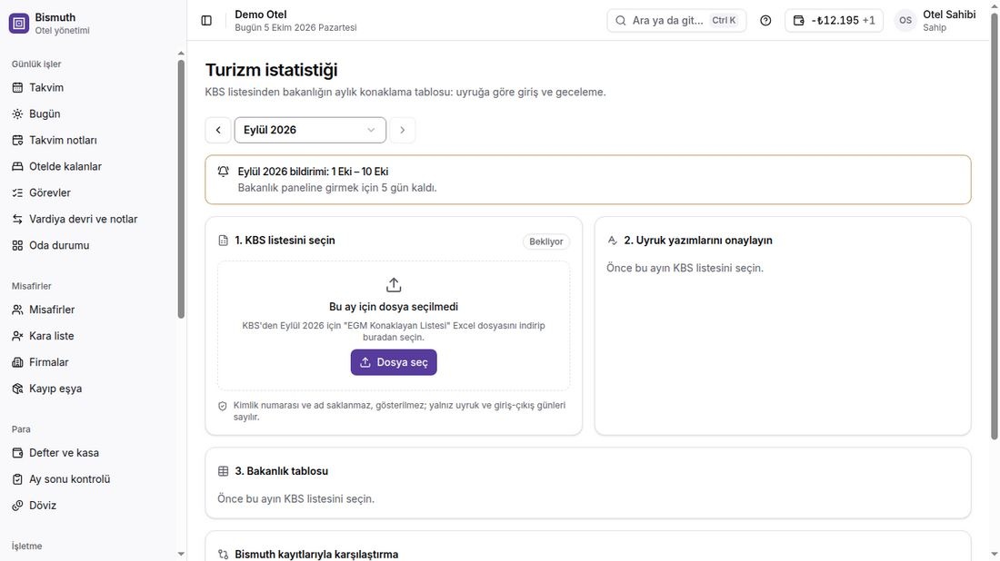

**1. KBS listesini seçin.** Dosyayı ekrandaki alana sürükleyin ya da **Dosya seç**'e basıp seçin. Program dosyanın ayını, satır sayısını, aynı gün giriş‑çıkışları ve otelde kalanları gösterir.

**2. Uyruk yazımlarını onaylayın.** KBS'de bazı ülkeler farklı yazılmış olabilir ("TÜRKYİE" gibi). Program öneri sunar:

- Öneri doğruysa **Kabul et**'e basın.
- Kıbrıs gibi kendiliğinden eşlenmeyen ya da tanınmayan yazımlarda listeden doğru ülkeyi seçip **Onayla**'ya basın.

Onayladığınız eşleşme sonraki aylarda hatırlanır; her ay yeniden sorulmaz.

**Otelde kalanlar** kutusu: ay sonunda hâlâ otelde olan misafirlerin geceleri, Bismuth'taki planlı çıkışa kadar sayılır. Yanlışsa **Düzelt** ile çıkış gününü seçin.

**3. Bakanlık tablosu.** Tablo bakanlık panelinin sırasıyla gelir: **Ülke**, **Toplam giriş**, **Toplam geceleme**; altında toplamlar, yatak sayısı ve doluluk.

- **Tabloyu kopyala** ile tablonun tamamını, satırdaki kopyala düğmesiyle tek satırı kopyalayıp bakanlık paneline yapıştırın. Onay bekleyen yazım varsa kopyalama kapalıdır.
- Panelde ülkeyi farklı bir adla yazıyorsanız ülke adındaki düğmeyle adı değiştirin; yeni ad sonraki aylarda da kullanılır.
- **Excel indir** ya da **CSV indir** ile dosya olarak alabilirsiniz.

### Kurallar

- Aynı gün giriş‑çıkış yapan kişi **1 geceleme** sayılır.
- Konaklamanın bütün geceleri **giriş ayına** yazılır; sonraki aya sarkan geceler de.
- Doluluk = geceleme ÷ (yatak sayısı × ayın gün sayısı). Yatak sayısı odalarınızdaki gerçek sayıdır.

### Bildirildi işareti

Tabloyu bakanlık paneline girdikten sonra **Bildirildi olarak işaretle**'ye basın. Tarih ve adınız **Geçmiş bildirimler** listesinde görünür; Bugün ekranındaki hatırlatma kalkar. Yanlışlıkla işaretlediyseniz **İşareti kaldır**.

### Bismuth kayıtlarıyla karşılaştırma

Ekranın altında KBS sayıları, aynı ay Bismuth'a girilen konaklamalarla karşılaştırılır:

- Ülke bazında farklar,
- **Uyruğu eksik** kişiler (misafir kartında uyruğu girin),
- **KBS'de olmayan** konaklamalar (KBS'ye bildirilmemiş olabilir; kontrol edin),
- **Bismuth'ta olmayan** girişler.

Bakanlığa her zaman KBS sayıları girilir; karşılaştırma yalnız kontrol içindir.

## 17. Yedek ve veri aktarma

Otelin bütün kayıtları ana bilgisayarda durur. Bilgisayar bozulursa ya da çalınırsa kayıtlar kaybolmasın diye Bismuth **her gün kendiliğinden yedek alır**: bir kopya bu bilgisayarda, şifreli bir kopya otelin Google Drive klasöründe. Bu bölüm yedekleri, geri yüklemeyi, Bismuth anahtarını ve Excel'e veri alıp vermeyi anlatır.

### Yedek durumu

**Ayarlar → Yedek** bölümünü açın.

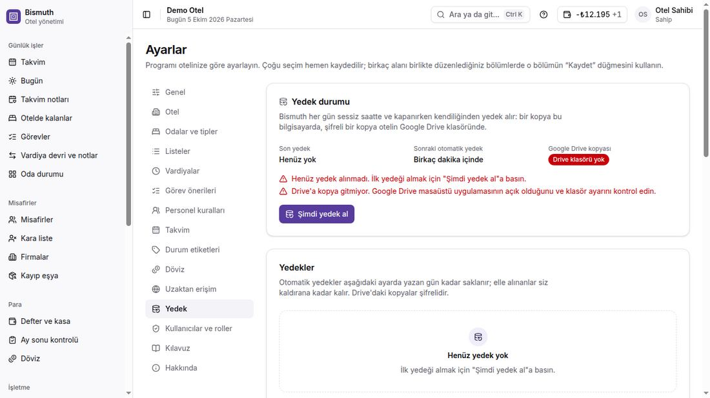

**Yedek durumu** kutusunda **Son yedek**, **Sonraki otomatik yedek** ve **Google Drive kopyası** durumu yazar. Otomatik yedek her gün otelin en sakin saatinde (varsayılan 04:00) ve program kapanırken alınır. O saatte program kapalıysa açıldıktan birkaç dakika sonra alınır.

Hemen yedek almak için **Şimdi yedek al**'a basın. Örneğin büyük bir değişiklikten önce ya da bilgisayarı taşımadan önce.

> [!WARNING]
> "İki gündür yedek alınmadı" ya da "Drive'a kopya gitmiyor" uyarısı görürseniz hemen bakın: Google Drive masaüstü uygulamasının açık olduğunu ve diskte yer olduğunu kontrol edin, sonra **Şimdi yedek al**'a basın. Uyarı Bugün ekranında da çıkar.

### Google Drive kopyası

Bismuth bir bulut hesabına bağlanmaz; yalnız bilgisayardaki Google Drive klasörüne dosya yazar, eşitlemeyi Google Drive uygulaması yapar. Bunun için ana bilgisayara **Google Drive masaüstü** uygulaması kurulu ve otelin hesabıyla açık olmalıdır.

Varsayılan klasör "Drive'ım/Bismuth/yedekler"dir; Klasörü görmek ya da değiştirmek için **Yedek ayarları** altında **Drive klasörünü bul**'a basın: Bismuth bu bilgisayardaki bilinen Drive klasörlerine (Windows'ta **G:** sürücüsü, Mac'te Finder'daki Google Drive) bakıp bulduğunu kaydeder; ağa bağlanmaz. Bulamazsa ya da başka bir klasör isterseniz **Klasör seç** ile seçin.

### Bismuth anahtarı

Drive'a giden yedekler **Bismuth anahtarı** ile şifrelenir; Google bile içini okuyamaz. Bilgisayar bozulursa yeni bilgisayarda yedeği açmak için bu anahtar gerekir.

1. **Bismuth anahtarı** kutusunda **Anahtarı göster**'e basın.
2. Anahtarı **kâğıda yazın** ve güvenli bir yerde (örneğin kasada) saklayın.

Yeni bir bilgisayarda Drive'daki yedeği açarken **Anahtarı gir** ile kâğıttaki anahtarı yazarsınız. Ana bilgisayarın anahtarını gösterme, girme ve değiştirme yalnız ana bilgisayarın kendi penceresinde yapılır; telefondan ya da ona uzaktan bağlanan bir bilgisayardan yapılamaz.

> [!WARNING]
> Anahtarı kaybederseniz Drive'daki şifreli yedekler açılamaz. Anahtarı yalnız güvendiğiniz kişiyle paylaşın.

### Yedekler listesi ve geri yükleme

**Yedekler** listesinde her yedeğin tarihi, türü (**Otomatik**, **Elle**, **Geri yükleme öncesi**, **Güncelleme öncesi**), yeri (**Bu bilgisayar** ya da **Google Drive (şifreli)**) ve boyutu yazar. Otomatik yedekler ayarda yazan gün kadar (varsayılan 30 gün) saklanır.

- **Denetle**: yedeğin sağlam olup olmadığını kontrol eder.
- **Geri yükle**: kayıtları o yedekteki hâline döndürür.

Geri yüklemek için:

1. Listede istediğiniz yedeğin **Geri yükle** düğmesine basın.
2. Uyarıyı okuyun: önce bugünkü veri ayrıca yedeklenir; geri yüklemeden sonra girilen kayıtlar o güvenlik yedeğinde kalır.
3. **Yedeği geri yükle** ile onaylayın.
4. **Şimdi yeniden başlat**'a basın. Program yeniden açılınca yedekteki veri gelir.

Vazgeçerseniz yeniden başlatmadan önce **Geri yüklemeyi iptal et**'e basın. Geri yükleme yalnız ana bilgisayardaki program penceresinden yapılabilir.

### Veri klasörü

**Veri klasörü** kutusu kayıtların ve eklerin (fotoğraflar, fişler) bilgisayarda nerede durduğunu ve boyutunu gösterir. **Klasörü aç** ile klasörü açabilirsiniz. Bu klasördeki dosyaları elle silmeyin ya da değiştirmeyin.

### Excel'e aktarmak (dışa aktar)

Rezervasyonları, defteri, personeli ya da başka bir tabloyu Excel'de açmak için:

1. **Ayarlar → Yedek** bölümünde **Dışa ve içe aktarma** kutusunda **Dışa aktar**'a basın.
2. **Tablo**'yu seçin ya da **Tüm tablolar**'ı.
3. **Dosya türü**: **Excel (XLSX)** (tarihler ve tutarlar biçimli, her tablo ayrı sayfa) ya da **CSV**.
4. İsterseniz **Başlangıç** ve **Bitiş** tarihi seçin.
5. **Dışa aktar**'a basın ve dosyayı kaydedeceğiniz yeri seçin.

Listede programdaki bütün kayıtlar var: rezervasyonlar ve defterin yanında odalar ve oda tipleri, satılmaz odalar, kasa teslimleri, vardiya devirleri ve pano notları, özel günler, kur geçmişi, çamaşırhane fiyatları ve ay hesapları, içe aktarmalar da. Her rol yalnız ekranda görebildiği tabloları görür.

Kimlik numaraları yalnız kimlik yetkisi olan rolde dosyaya yazılır. Tanıtıcı notlar ve kişisel notlar (**Kendime not**) hiçbir dosyaya yazılmaz. Sahip bölümünü ya da maaşları göremeyen rolde kasa teslimi tutarları bu satırlar olmadan hesaplanır.

### Eski e‑tabloları almak (içe aktar)

Excel ya da Google E‑Tablo'da tuttuğunuz eski rezervasyon, defter ve maaş sayfalarını programa alabilirsiniz. Son adıma kadar hiçbir şey kaydedilmez.

1. **İçe aktar**'a basın.
2. **Şablon**'u seçin: **Rezervasyon (oda × gün)** (her satır bir oda, her sütun bir gün; hücrede "AD SOYAD (fiyat)"), **Defter (günlük satırlar)** ya da **Maaşlar (çalışan × ay)** (personel, ay, maaş, ödenen, ödeme yöntemi; çalışanlar önce Personel ekranında olmalı). **Örnek dosyayı indir** sütun adları hazır bir dosya verir.
3. **Dosya**: CSV ya da XLSX (en çok 5 MB). Google E‑Tablo'da Dosya → İndir menüsünden alabilirsiniz. **Devam**'a basın.
4. **Sütunlar**: programın bulduğu sütunları kontrol edin; gerekirse ayı, satış kanalını ve ödeme yöntemini seçin. **Önizle**'ye basın.
5. **Önizleme**: alınacak kayıtları ve sorunlu satırları görün. Aynı kişi farklı yazılmış olabilir; içe aldıktan sonra Misafirler ekranında birleştirebilirsiniz.
6. **… kaydı içe al**'a basın.

Sorunlu satırlar alınmaz. Dosyada düzeltip dosyanın tamamını yeniden içe alabilirsiniz: daha önce alınmış satırlar **Alınmış** diye işaretlenir ve ikinci kez yazılmaz.

Yanlış bir dosya aldıysanız aynı kutudaki **İçe aktarmalar** listesinde **Aktarımı iptal et**'e basıp nedenini yazın: o aktarımın yazdığı kayıtlar silinmez, iptal edilir.

> [!TIP]
> XLSX dosyasında hücre renkleri ödeme durumu olarak okunur (kırmızı = ödendi). Hem rezervasyonu hem defteri alacaksanız, rezervasyon içe aktarırken ödeme yazmayı kapatın; yoksa aynı gelir iki kez sayılır.

## 18. Uzaktan erişim (Mac ve telefon)

Otel sahibi evdeki Mac'inden ya da telefonundan otelin kayıtlarını görebilir ve yetkisi olan işleri yapabilir. Bunun için bizim bir sunucumuz ya da ücretli bir hizmet yoktur: oteldeki bilgisayar **ana bilgisayar** olur, diğer cihazlar ona ücretsiz bir **özel ağ** uygulaması (NetBird) üzerinden bağlanır. Kayıtlar her zaman ana bilgisayarda kalır.

### Çalışma şekilleri

**Ayarlar → Uzaktan erişim** bölümündeki **Bu bilgisayar** kutusunda üç seçenek vardır:

- **Tek bilgisayar**: kimse uzaktan bağlanmaz. Küçük oteller için yeterlidir.
- **Otelin ana bilgisayarı**: asıl veriler bu bilgisayarda; diğer bilgisayarlar ve telefonlar buna bağlanır.
- **Başka bir Bismuth'a bağlan**: örneğin sahibin Mac'i; ana bilgisayardaki verilerle çalışır.

Bu ayarlar yalnız ana bilgisayarın kendi penceresinde değişir; telefondan ya da Mac'ten değiştirilemez.

Bilgisayarı **Otelin ana bilgisayarı** yapınca **Ana bilgisayar çalışıyor** yazar ve bağlanılacak adres görünür: **Dışarıdan (NetBird)**. Adresin yanındaki QR kodu telefonun kamerasıyla okutabilirsiniz. NetBird bu bilgisayarda açık değilse "Özel ağ adresi bulunamadı" yazar; aşağıdaki kurulumu yapın.

Aynı kutuda şunlar da vardır:

- **Otelin ağından bağlantı**: varsayılan olarak **kapalıdır**; telefonlar ve diğer bilgisayarlar yalnız özel ağdan (NetBird) bağlanır, çünkü özel ağ bağlantıyı şifreler. Açarsanız otelin Wi‑Fi ya da kablolu ağındaki cihazlar da bağlanabilir ve **Otel içinden (Wi‑Fi)** adresi görünür. Açarken bir uyarı çıkar: otelin ağında bağlantı şifresizdir, misafirlerin bağlandığı Wi‑Fi otelin kendi ağından ayrı olmalıdır (modemdeki "misafir ağı"). Emin değilseniz kapalı bırakın; NetBird otel içinde de çalışır.
- **Bu bilgisayarın kimliği**: "4514-284E-…" gibi bir sayı. Mac ilk bağlandığında bu kimliği aklında tutar; Mac'in **Ayarlar → Uzaktan erişim** ekranında aynı kimliği görmelisiniz.
- **Bağlantı noktası (port)**: genellikle değiştirmeyin (7373).

### Dışarıdan erişimi kurmak (bir kez)

Bu işi otel sahibi bir kez yapar; yaklaşık yarım saat sürer. Ekrandaki **Dışarıdan erişim kurulumu** kutusunda dört adım vardır:

1. **Ana bilgisayara NetBird'ü kurun**: NetBird'ün sitesinde otelin Gmail hesabıyla ücretsiz ağı açın, ana bilgisayarı kurulum anahtarıyla bağlayın ve NetBird panelinde bu cihaz için oturum süresinin dolmasını kapatın.
2. **Sahibi davet edin**: NetBird panelinde **Users → Invite** ile sahibin kendi e‑posta adresine davet gönderin.
3. **Mac'e ve telefona NetBird kurun**: sahip daveti kendi hesabıyla kabul eder ve NetBird'ü Mac'e ve telefona kurar (App Store ya da Google Play).
4. **Bağlanın**: Mac'te Bismuth'u açıp **Başka bir Bismuth'a bağlan**'ı seçin; telefonda "Dışarıdan" adresinin QR kodunu okutun.

Yanındaki **Hep açık** kutusu ana bilgisayarın hep ulaşılır kalması için yapılacakları sıralar. **Bilgisayar açılınca Bismuth'u başlat**'ı açın.

> [!TIP]
> Ana bilgisayar kapanmamalı ve uyku moduna geçmemelidir; yoksa dışarıdan erişim kesilir. Windows'ta Ayarlar → Sistem → Güç → Uyku: "Hiçbir zaman" seçin.

### Mac'ten bağlanmak

1. Mac'e Bismuth'u kurun ve açın.
2. Kurulumun **Çalışma şekli** adımında **Başka bir Bismuth'a bağlan**'ı seçin ve **Bağlantı ekranına geç**'e basın.
3. **Ana bilgisayarın adresi** alanına "Dışarıdan" adresini yazın ve **Bağlan**'a basın. Otel içindeyseniz ve otelin ağından bağlantı açıksa **Yerel ağda bulunanlar** listesinden de seçebilirsiniz.
4. Kullanıcı adınız ve şifrenizle oturum açın.

Bağlıyken üst çubukta **Ana bilgisayara bağlı** rozeti görünür. Mac'te yazdığınız her şey doğrudan ana bilgisayara yazılır.

Mac'in **Ayarlar → Uzaktan erişim** ekranında ana bilgisayarın adresi, durumu ve **Bilinen kimlik** yazar. Bu adreste başka bir bilgisayar cevap verirse **Ana bilgisayarın kimliği değişti** uyarısı çıkar ve hiçbir bilgi gönderilmez. Yalnız ana bilgisayar gerçekten değiştiyse (devralındı ya da yeniden kuruldu) kimliği ana bilgisayarın ekranındakiyle karşılaştırıp **Yeni kimliği kabul et**'e basın.

Mac, ana bilgisayardaki bütün kayıtların salt okunur bir **yedek kopyasını** tutar. Ana bilgisayar kapalıyken ya da internet yokken ekranlar bu kopyadan açılır; üstte kopyanın saati yazar ve kayıt değiştirilemez. Bağlantı gelince kendiliğinden canlıya döner. NetBird kapalıyken kopya, otelin Drive'ındaki şifreli kutudan güncellenir; bunun için Mac'te **Yedek kopya** kutusunda Drive klasörünü seçip kâğıttaki **Bismuth anahtarını** bir kez girin.

### Telefondan bağlanmak

1. Telefonda NetBird uygulamasının açık olduğundan emin olun.
2. Tarayıcıda ana bilgisayarın adresini açın ya da ana bilgisayarın ekranındaki QR kodunu telefonun kamerasıyla okutun.
3. Kullanıcı adınız ve şifrenizle oturum açın. PIN telefonda ve Mac'te kullanılmaz; PIN yalnız ana bilgisayarın kendi penceresinde geçerlidir.
4. Tarayıcının menüsünden **Ana ekrana ekle**'yi seçin; Bismuth uygulama gibi açılır.

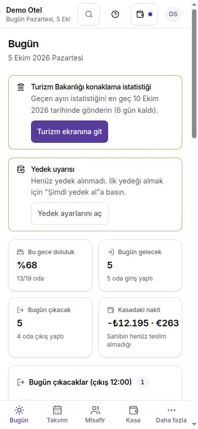

Telefonda alt menüde **Bugün · Takvim · Misafir · Kasa · Daha fazla** vardır. Telefondan ödeme girebilir, arıza açabilir, oda durumunu değiştirebilir, görevi yapıldı olarak işaretleyebilir, vardiya notlarını ve otelde kalanları görebilirsiniz.

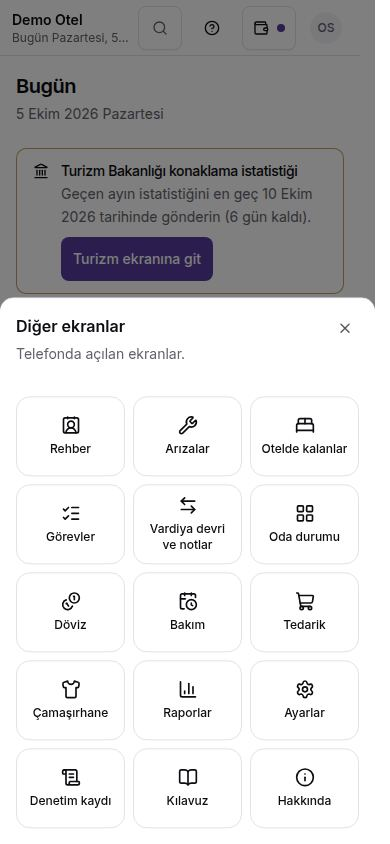

### Güvenlik

- Telefon ve diğer bilgisayarlardaki oturum belli bir süre sonunda kapanır; yeniden oturum açılır. Bu süre **Oturum güvenliği** kutusundaki **Uzaktan oturum süresi** ile seçilir.
- Ağdan 5 yanlış şifreden sonra uzaktan giriş 15 dakika kilitlenir; ana bilgisayardaki pencere bundan etkilenmez.
- **Bağlı cihazlar** listesinde hangi cihazın ne zaman bağlandığı yazar. Tanımadığınız ya da kaybolan bir cihaz için **Oturumu kapat** ya da **Cihazı çıkar**'a basın.
- Bir rolün nereden oturum açacağını **Ayarlar → Kullanıcılar ve roller**'de o rolün **Uzaktan oturum açma** seçeneğiyle belirlersiniz: **Her yerden**, **Yalnız otelin ağından** ya da **Kapalı (yalnız ana bilgisayarda)**.
- Ana bilgisayarın Bismuth anahtarını gösterme, girme ve değiştirme ile Drive klasörünü seçme yalnız ana bilgisayarın kendi penceresinde yapılır. (Mac, kendi yedek kopyası için anahtarı kendi penceresinde girer.)
- Dizüstü bilgisayarlarda disk şifrelemesini (Mac'te FileVault, Windows'ta BitLocker) açmanızı öneririz.

### Ana bilgisayar bozulursa

Drive'daki şifreli yedekler ve Mac'teki yedek kopya sayesinde kayıtlar kaybolmaz. Ana bilgisayar tamamen bozulursa Mac'te **Ayarlar → Uzaktan erişim** ekranındaki **Ana bilgisayar bozuldu mu?** kutusunda **Bu bilgisayarı ana bilgisayar yap**'a basın:

1. Pencerede ne olacağı yazar: yedek kopyadaki son bilgiler bu bilgisayarın kayıtları olur ve Drive kutusuna yeni dönem notu yazılır.
2. Kâğıttaki **Bismuth anahtarını** yazın (bu bilgisayara girilen anahtarla aynı olmalı).
3. Kendi **yeni şifrenizi** iki kez yazın. Diğer kullanıcıların şifrelerini sonra **Ayarlar → Kullanıcılar ve roller**'den yenileyin.
4. **Ana bilgisayar yap**'a basın. Bismuth yeniden başlar ve ana bilgisayar olarak açılır.

Eski bilgisayar geri gelirse yeni dönem notunu görür ve değişiklik kabul etmez; ekranında, yeni ana bilgisayarın bilmediği değişikliklerin listesi çıkar. Bkz. [Bismuth anahtarı](#backup-key).

### Sorun giderme

- **Bağlanamıyorum**: ana bilgisayar açık mı, uyku modunda mı? NetBird iki cihazda da açık mı? Adres doğru mu?
- **Telefon açılmıyor**: NetBird'ün açık olduğunu kontrol edin ve "Dışarıdan" adresini kullanın. "Otel içinden" adresi yalnız otelin ağından bağlantı açıksa çalışır.
- **"Ana bilgisayarın kimliği değişti"**: ana bilgisayarı siz değiştirmediyseniz kabul etmeyin ve otel sahibine haber verin.
- **Mac salt okunur**: ana bilgisayara ulaşılamıyordur; bağlantı gelince kendiliğinden düzelir.
- **"Bismuth sürümleri farklı"**: iki bilgisayardaki Bismuth'u aynı sürüme getirin.

## 19. Ayarlar, kullanıcılar ve roller

Otele özgü her kural Bismuth'ta bir **ayardır**: saatler, odalar, fiyatlar, ödeme yöntemleri, vardiyalar, renkler, izin kuralları. Bu bölüm **Ayarlar** ekranını, kullanıcı hesaplarını ve rolleri anlatır. Çoğu ayarı yalnız otel sahibi değiştirebilir.

Sol menüde **Sistem → Ayarlar**'ı açın. Bilgisayarda bölümler solda listelenir; telefonda üstteki kutudan bölüm seçilir. Rolünüzün göremediği bölümler listede çıkmaz; yalnız görebildiğiniz bölümde "Yalnız görüntüleme" yazar.

### Genel

Her kullanıcının **kendi** seçimleri: **Dil**, **Açılış ekranı**, **Tema**, **Yoğunluk**, **Kuruşları göster**. Birinin seçimi diğerini etkilemez. **Ekran kilidi** kutusundaki **Kilitlenme süresi** ise otelin bütün bilgisayarları için geçerlidir ve otel sahibi seçer.

### Otel

**Otel bilgileri**: otel adı, ülke (resmî tatiller buna göre), şehir (hava durumu için), **Otelin e-posta adresi** (yalnız hava durumu servisine kimin sorduğunu söylemek için; boş bırakılabilir), saat dilimi, **Giriş saati**, **Çıkış saati** (bu saat geçince çıkmayan oda gecikmiş görünür), **Ana para birimi** ve **Kabul edilen para birimleri**. Değişiklikler **Kaydet**'e basınca uygulanır. Ana para birimi, kayıt girildikten sonra değiştirilemez.

### Odalar ve tipler

- **Oda tipleri**: kullandığınız tipler ve önerilen fiyatları (**Hafta içi fiyatı**, **Hafta sonu fiyatı**). **Hazır tiplerden seç** ya da **Tip ekle**.
- **Odalar**: numara, kat, tip ve yatak sayısı. **Oda ekle** ya da kat kat **Toplu ekle**.
- **Satılabilir** kapalı oda takvimde görünür ama satılmaz (örneğin personel odası). **Kullanımda** kapatılan oda takvimden çıkar; eski kayıtları kalır.
- Yatak sayısı değişince **Geçerlilik tarihi** girin; geçmiş ayların doluluk ve bakanlık istatistiği o tarihteki sayıyla hesaplanır.

Odalar silinmez; kullanılmayan oda kapatılır.

### Listeler

**Ödeme yöntemleri**, **Satış kanalları**, **Ek hizmetler**, **Gider bölümleri**, **Çamaşır türleri** ve **Ürün kategorileri**. Hazır satırları yeniden adlandırabilir, sıralayabilir, kullanmadığınızı kapatabilirsiniz; satırlar silinmez.

- Ödeme yöntemi için **Nakit ödeme** açıksa bu yöntemle alınan para kasaya girer.
- Satış kanalı için **Komisyon (%)** ve **Parayı kim alır** (Otel ya da Kanal) yazılabilir. Kanallar yalnız etikettir; Bismuth Booking, Airbnb gibi sitelere bağlanmaz.
- Ek hizmet için **Önerilen fiyat** ve **Birim** (rezervasyon başına, gece başına, kişi başına…).

### Vardiyalar

Vardiya adları ve saatleri (örneğin Gündüz 09:00–21:00, Gece 21:00–09:00). Bitiş başlangıçtan önceyse vardiya ertesi gün biter. Vardiya devri ve görevler bu vardiyalara göre düzenlenir.

### Takvim

**Vurgulu günler** (takvimde farklı renkte görünen günler, örneğin hafta sonu), **Hafta sonu fiyatı uygulanan geceler** (bu günlerde başlayan geceler oda tipinin hafta sonu fiyatını alır; varsayılan cuma ve cumartesi; vurgulu günlerden ayrıdır), **Gün kapatma** ve bu yılın bayramları. Bkz. [Gün kapatma](#day-closing).

**Takvim başlangıç yılı**: takvimin geriye ne kadar gideceği. Daha eski bir konaklama varsa takvim onun yılından başlar; boş bırakırsanız en eski konaklamanın yılından.

### Durum etiketleri ve renkler

Takvimdeki renklerin anlamı burada ayarlanır.

- **Otomatik durumlar**: program ödemeden ve tarihten kendisi bulur: Ödendi, Ödenmedi, Kısmen ödendi / kapora, Aynı gün giriş‑çıkış, Geçmiş tarih, boş; Boş; Satılmaz. Adlarını, renklerini ve anlamlarını değiştirebilir, istemediğinizi kapatabilirsiniz.
- **Kendi etiketleriniz**: rezervasyona taktığınız etiketler (Grup, Sorunlu misafir, Uzun konaklama…). **Etiket ekle** ile ad, renk ve anlam verin. "Takvimde hücreyi bu renk doldursun" seçilirse etiket dolguyu alır, ödeme durumu kenara geçer.
- Açık ve koyu temanın renkleri ayrıdır. Okunması zor bir renk seçerseniz "Bu renkte yazı zor okunur" uyarısı çıkar.
- **Takvim önizlemesi** değişiklikleri hemen gösterir; **Varsayılan renklere dön** baştaki renklere döner.

Bütün renkleri ve bileşenleri açık ve koyu temada görmek için menüde **Tema önizleme** vardır.

### Kullanıcılar

Herkes kendi adıyla oturum açar; kim ne yaptı denetim kaydında görünür. **Kullanıcılar ve roller** bölümünde:

1. **Kullanıcı ekle**'ye basın.
2. **Kullanıcı adı** (sonradan değişmez), **Görünen ad**, **Rol** ve **Geçici şifre** (en az 8 karakter) yazın.
3. Çalışanın personel kartı varsa **Personel kartı**'ndan bağlayın; çalışan kendi mesai saatlerini girer.
4. Kaydedin ve geçici şifreyi çalışana iletin. İlk oturum açışta kendi şifresini belirler.

Bir kullanıcı şifresini unutursa **Şifre sıfırla** ile yeni geçici şifre verin. İşten ayrılan kişi için **Hesabı kapat**; kayıtları ve geçmişi kalır, hesap istenirse yeniden açılır. Son sahip hesabı kapatılamaz.

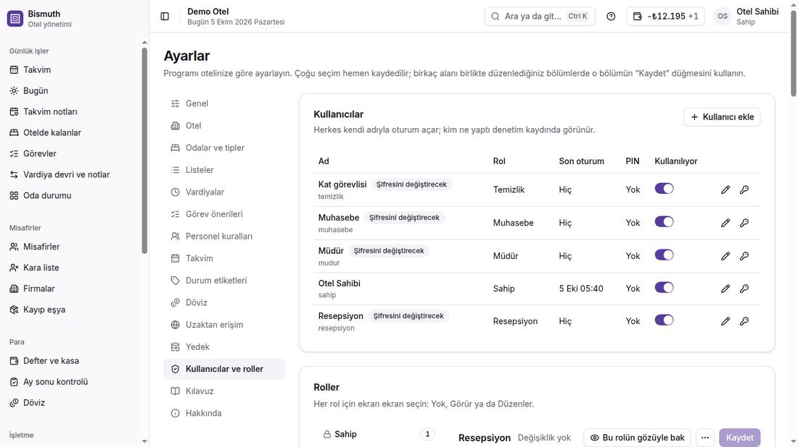

### Roller

Rol, bir kullanıcının hangi ekranı görebileceğini ve neyi değiştirebileceğini belirler. Hazır roller: **Sahip**, **Müdür**, **Resepsiyon**, **Muhasebe**, **Temizlik**, **Çalışan**. Sahip rolü her şeyi görür ve değiştirilemez.

1. **Roller** kutusunda rolü seçin.
2. Her ekran için **Yok**, **Görür** ya da **Düzenler**'i seçin.
3. **Kaydet**'e basın.

- **Rol ekle** ile yeni rol açılır; yeni rol hiçbir şeyi görmeden başlar. Var olan bir rolden başlamak için o rolde **Kopyala**'yı kullanın.
- **Uzaktan oturum açabilir**: kapalıysa bu roldeki kullanıcılar yalnız otelin bilgisayarlarından girer.
- **Yalnız kendi görevleri**: açıksa bu roldeki kullanıcılar yalnız kendilerine verilen görevleri görür.
- **Bu rolün gözüyle bak**: menüyü ve ekranları o rolün gördüğü gibi gösterir; üstteki şeritten **Önizlemeyi kapat** ile çıkılır.

> [!TIP]
> Bir ekranı menüden gizlemek tek başına koruma değildir; Bismuth her işlemde yetkiyi ayrıca denetler. Yetkisi olmayan biri adresle bir ekranı açarsa "Bu ekrana yetkiniz yok" yazar.

### Denetim kaydı

**Sistem → Denetim kaydı** ekranı (varsayılan olarak yalnız sahip görür) kimin, ne zaman, hangi cihazdan neyi eklediğini, değiştirdiğini ya da iptal ettiğini listeler. **Filtre** ile tarih, kişi, kayıt türü ve işlem seçin; bir satıra tıklayınca önceki ve sonraki değerler görünür. Kayıtlar silinmez.

### Kılavuz ayarı

**Ayarlar → Kılavuz** bölümünde kılavuzu açar, tanıtım turunu yeniden başlatırsınız. **Yeni kullanıcılara tanıtım turunu göster** açıksa her kullanıcı ilk oturum açışında kısa turu bir kez görür.

## 20. Sık sorulanlar ve sorun giderme

En sık karşılaşılan sorular ve ne yapmanız gerektiği. Burada cevabını bulamadığınız bir sorun olursa otel sahibine haber verin.

### İnternet kesildi; çalışabilir miyim?

Evet. Bismuth internet olmadan da çalışır; rezervasyon, ödeme, gider, KBS işareti her şey aynen yazılır. Yalnız döviz kuru, hava durumu ve bayram denetimi güncellenmez: dövizli ödemelerde son bilinen kur kullanılır. İnternet gelince kendiliğinden yenilenir.

### Bir kaydı yanlış yazdım; nasıl silerim?

Bismuth'ta kayıt silinmez; düzeltilir ya da iptal edilir. Böylece kimin neyi değiştirdiği her zaman bellidir.

- Rezervasyon: panelde **Geceler** sekmesinden düzeltin ya da **Diğer işlemler → Rezervasyonu iptal et**.
- Ödeme ya da gider: **Defter ve kasa** ekranında satır işlemlerinden **Düzenle** ya da **İptal et**.
- Görev: **Diğer işlemler → Görevi iptal et**.

### Oda dolu diyor ama boş görünüyor

Takvimde o oda için seçtiğiniz günleri kontrol edin: başka bir rezervasyonun son gecesi ya da satışa kapalı (çizgili) bir gün olabilir. Çıkış günü gece sayılmaz; bir misafirin çıktığı gün aynı odaya yeni misafir girebilir. Park alanındaki rezervasyonlar odayı tutmaz.

### Çubuğun rengi neden değişmedi?

Renk ödemeye göredir. Ödemeyi rezervasyona değil "Ek satış" olarak yazdıysanız renk değişmez. Rezervasyonun **Para** sekmesini açıp ödemenin orada olduğunu kontrol edin. Ödeme gecelere sırayla dağılır; tutar tek geceyi karşılıyorsa yalnız ilk gece ödendi görünür.

### "Bu işlem için yetkiniz yok" yazıyor

Rolünüz bu işi yapmaya izin vermiyor. Gerekirse otel sahibine başvurun; sahip **Ayarlar → Kullanıcılar ve roller**'den rolünüzün yetkisini değiştirebilir.

### Şifremi ya da PIN'imi unuttum

Oturum açma ekranında **Şifremi unuttum**'a basıp kurtarma kodlarınızdan biriyle yeni şifre belirleyin. Kodunuz yoksa otel sahibi **Şifre sıfırla** ile size geçici şifre verir. PIN'i unuttuysanız şifrenizle oturum açıp hesap menüsünden **PIN'i değiştir**'i seçin. Bkz. [Şifremi unuttum](#forgot-password).

### Ekran kendiliğinden kilitleniyor

Bir süre işlem yapılmayınca pencere güvenlik için kilitlenir. PIN'inizi yazıp devam edin. Sürenin değişmesi gerekiyorsa otel sahibi **Ayarlar → Genel → Ekran kilidi**'nden ayarlar.

### Kasadaki para "Kasada olmalı" ile tutmuyor

1. Bugünün defterinde nakit ödemeleri ve **Kasadan ödendi** işaretli giderleri kontrol edin; yazılmamış bir ödeme ya da gider var mı?
2. Kasadan verilen avanslar personel ekranından yazılmış mı?
3. Yanlış para birimiyle yazılmış satır var mı?

Farkı bulamazsanız **Gün notu**'na yazın ve sahibe haber verin.

### Ekrandaki yazılar çok küçük ya da çok sığışık

Program menüsündeki **Görünüm** altında **Büyüt** ve **Küçült** vardır (Windows'ta <kbd>Ctrl</kbd> + <kbd>+</kbd> ve <kbd>Ctrl</kbd> + <kbd>-</kbd>, Mac'te <kbd>⌘</kbd> + <kbd>+</kbd> ve <kbd>⌘</kbd> + <kbd>-</kbd>); **Gerçek boyut** eski hâline döndürür. Satırlar sıkışık geliyorsa **Ayarlar → Genel → Yoğunluk**'u **Rahat** yapın.

### Program açılmıyor ya da "Veriler açılamadı" diyor

Programı kapatıp yeniden açın. Sorun sürerse otel sahibine haber verin ve ekranda yazan veri klasörünü **silmeyin**. Verileriniz silinmez; gerekirse son yedekten geri yüklenir. Bkz. [Yedek ve veri aktarma](#backup).

### Program hakkında bilgi

**Sistem → Hakkında** ekranında programın sürümü, veri klasörü, veri denetiminin sonucu ve kullanılan açık kaynak bileşenler yazar. Destek isteyen biri sürümü sorarsa buraya bakın.

Bismuth izleme, reklam ve otomatik güncelleme içermez. Verileriniz bu bilgisayardaki veri klasöründe durur ve hiçbir yere gönderilmez. İnternetten yalnız piyasa kuru, otelin şehri için hava durumu ve yılda bir bayram tarihleri okunur; Döviz ekranındaki **İnternetten güncelle** anahtarı hepsini kapatır.

## 21. Kurulum ve yeni sürüm

Bu bölüm Bismuth'u Windows ya da Mac bilgisayara kurmayı, ilk açılışta çıkan uyarıları, kurulum bilgilerini kâğıda yazmayı ve yeni sürümü kurmayı anlatır. Teknik bilgi gerekmez; çift tıklamak yeter. Kurulumdan sonra kurulum sihirbazı için [İlk kurulum](#setup) bölümüne bakın.

### Önce bilmeniz gerekenler

- Bismuth **internet olmadan** çalışır. Kurduktan sonra internet gerekmez; kayıtlarınız bu bilgisayarda durur.
- Bismuth **kendiliğinden güncellenmez** ve bir yere veri göndermez. Yeni sürüm çıkarsa elle kurarsınız.
- Kurulum dosyası **imzasızdır**: imza, yayıncının her yıl Microsoft'a ya da Apple'a ödediği bir ücrettir. Bu yüzden Windows ve Mac ilk açılışta bir uyarı gösterir. Uyarı programın zararlı olduğu anlamına gelmez; hangi düğmeye basacağınız aşağıda yazıyor. Uyarı **yalnızca bir kez** çıkar.
- Kurulum için yönetici şifresi gerekmez; program yalnız kurduğunuz kullanıcıya kurulur.

Dosyalar proje sayfasındaki **Releases** (sürümler) bölümünde, en yeni sürümün **Assets** (dosyalar) listesindedir:

- Windows 10 ya da 11 (çoğu bilgisayar): **Bismuth-Setup.exe**
- Windows, ARM işlemcili (az rastlanır): **Bismuth-Setup-arm64.exe**
- Mac, Apple çipli (M1, M2, M3, M4): **Bismuth.dmg**
- Mac, Intel işlemcili: **Bismuth-Intel.dmg**

Emin değilseniz Windows için **Bismuth-Setup.exe**'yi seçin. Mac'te Apple simgesi → **Bu Mac Hakkında** altında **Çip: Apple M…** yazıyorsa **Bismuth.dmg**, **İşlemci: Intel** yazıyorsa **Bismuth-Intel.dmg** indirin. Yanlış dosya zarar vermez; doğrusunu indirip yeniden deneyin.

### Windows'a kurmak

1. İndirdiğiniz **Bismuth-Setup.exe** dosyasına çift tıklayın. Tarayıcı "bu dosya yaygın olarak indirilmiyor" derse dosyanın yanındaki **⋯** düğmesine basıp **Yine de sakla**'yı seçin.
2. Mavi **"Windows bilgisayarınızı korudu"** penceresi çıkarsa **Ek bilgi**'ye, sonra **Yine de çalıştır**'a basın.
3. Kurulum penceresinde **İleri**'ye, sonra **Kur**'a basın; bitince **Bitir**'e basın.
4. Masaüstünde ve Başlat menüsünde **Bismuth** kısayolu oluşur.

> [!WARNING]
> Bismuth'u otelin ortak bilgisayarında hangi Windows kullanıcısıyla kurduysanız her gün **o kullanıcıyla** açın. Başka bir Windows kullanıcısı açarsa kendi boş verisini görür; otel kayıtları kurulumu yapan kullanıcının klasöründedir.

Bu bilgisayar otelin **ana bilgisayarı** olacaksa Windows ilk açılışta güvenlik duvarı sorusu sorabilir; **Özel ağlar**'ı işaretleyip **Erişime izin ver**'e basın. Bilgisayar tek başına çalışacaksa **İptal**'e basın, hiçbir şey bozulmaz.

### Mac'e kurmak

1. **.dmg** dosyasına çift tıklayın; açılan pencerede **Bismuth** simgesini **Uygulamalar** klasörüne sürükleyip bırakın.
2. **Uygulamalar**'dan **Bismuth**'a çift tıklayın. Mac "açılmadı" uyarısı verir: **Bitti**'ye basın (**Çöp Kutusu'na Taşı**'ya basmayın).
3. Apple menüsü → **Sistem Ayarları** → **Gizlilik ve Güvenlik**'i açın; en alta kaydırın. **"Bismuth" engellendi** satırında **Yine de aç**'a basın, istenirse Mac şifrenizi yazın ve son pencerede **Aç**'a basın.
4. Bundan sonra uyarı çıkmaz; Bismuth'u Launchpad'den ya da Dock'tan açarsınız.

Satır görünmüyorsa 2. adımdaki uyarıyı gördükten sonra **Gizlilik ve Güvenlik**'e bakın; satır kısa süre sonra belirir ve bir saat kadar kalır. Yine yoksa Bismuth'u yeniden açın.

Mac, ilk açılışta ya da yeni sürümden sonra "Bismuth, anahtar zincirinizdeki gizli bilgileri kullanmak istiyor" diye sorabilir. Mac şifrenizi yazıp **Her Zaman İzin Ver**'e basın; **Reddet**'e basarsanız Bismuth anahtarı okuyamaz.

### Kurulum bilgilerini kâğıda yazın

Kurulum sihirbazının sonunda **Kâğıda yazın** adımı çıkar. İki bilgi bir kez gösterilir:

- **Kurtarma kodları**: şifrenizi unutursanız yeni şifre belirlemek içindir.
- **Bismuth anahtarı**: Drive'a giden şifreli yedekleri yeni bir bilgisayarda açmak içindir. Kaybolursa o yedekler açılamaz.

**Yazdır**'a basarsanız ikisi tek bir A4 sayfaya basılır (anahtarın QR koduyla birlikte); kâğıda elle de yazabilirsiniz. Sonra **Kâğıda yazdım**'ı işaretleyip **Programa geç**'e basın. Kâğıdı kasada ya da bilgisayardan ayrı güvenli bir yerde saklayın; fotoğrafını çekip paylaşmayın. Anahtar o an gösterilemezse program bunu yazar; anahtarı sonra **Ayarlar → Yedek → Anahtarı göster** ile alırsınız. Ayrıntı: [Bismuth anahtarı](#backup-key).

### Google Drive klasörü

Yedeğin şifreli bir kopyası otelin Google Drive'ına gider. Bunun için ana bilgisayara **Google Drive masaüstü** uygulamasını kurup otelin hesabıyla açın. Sonra **Ayarlar → Yedek**'te **Drive klasörünü bul**'a basın: Bismuth bu bilgisayardaki bilinen Drive klasörlerine bakar, bulduğunu kaydeder. Bulamazsa bunu söyler; o zaman Drive uygulamasının açık olduğunu kontrol edin ya da **Klasör seç** ile klasörü kendiniz seçin. Bismuth hiçbir zaman Google'a bağlanmaz; yalnız bu bilgisayardaki klasöre dosya yazar. Ayrıntı: [Google Drive kopyası](#drive-copy).

### Yeni sürümü kurmak

1. **Ayarlar → Yedek → Şimdi yedek al**'a basın.
2. Bismuth'u kapatın.
3. Yeni sürümün kurulum dosyasını indirip yukarıdaki gibi açın. Windows'ta eski sürümün **üzerine** kurulur; Mac'te **Bismuth**'u **Uygulamalar**'a sürükleyip **Değiştir**'i seçin. Uyarı yine çıkarsa aynı adımları izleyin.
4. Bismuth'u açın; kayıtlarınızın hepsi yerindedir. Program veri düzenini gerekirse kendisi uyarlar ve önce **Güncelleme öncesi** adıyla bir kopya alır.

> [!WARNING]
> Daha eski bir sürümü yeni sürümün kayıtları üzerine kurmayın; eski sürüm yeni verileri açamayabilir. Ana bilgisayarla Mac'teki Bismuth aynı sürümde olmalıdır: önce otel bilgisayarını, sonra Mac'i güncelleyin.

### Bismuth'u kaldırmak

Kaldırmak kayıtlarınızı **silmez**; veri klasörü yerinde kalır, sonradan yeniden kurarsanız her şey karşınıza gelir.

- **Windows:** Başlat → Ayarlar → Uygulamalar → **Bismuth** → **Kaldır**.
- **Mac:** **Uygulamalar** klasöründen **Bismuth**'u Çöp Kutusu'na sürükleyin.

Kayıtlarınızı da silecekseniz (örneğin bilgisayarı satıyorsanız) önce **Şimdi yedek al** ile yedek alıp güvenli bir yere kopyalayın. Veri klasörünün yeri **Ayarlar → Yedek → Veri klasörü** bölümünde yazar; **Klasörü aç** düğmesi onu açar.

### Kurulum sorunları

**Windows'ta "Yine de çalıştır" düğmesi yok.** Önce **Ek bilgi**'ye basın; düğme altında çıkar. Bilgisayar bir şirket ya da okul ilkesiyle yönetiliyorsa yönetici uygulamayı engellemiş olabilir.

**Mac'te "Yine de aç" satırı çıkmıyor ya da "hasarlı" diyor.** Bismuth'u indirilenler klasöründen değil **Uygulamalar** klasöründen açtığınızdan emin olup yukarıdaki adımları yeniden deneyin. Olmazsa programı sizin için kuran kişiye ya da geliştiriciye haber verin.

**Mac "Bu uygulama bu Mac'te çalışmıyor" diyor.** Yanlış dosyayı indirmişsiniz (Apple çipli Mac'e **Bismuth.dmg**, Intel Mac'e **Bismuth-Intel.dmg** gerekir). Doğru dosyayı indirin.

**Program açılmıyor, hiçbir şey olmuyor.** Bismuth aynı anda bir kez açılır; küçültülmüş olabilir (görev çubuğu ya da Dock). Yine de açılmazsa bilgisayarı yeniden başlatın. Verileriniz silinmedi; veri klasörünü silmeyin ve otel sahibine haber verin.
