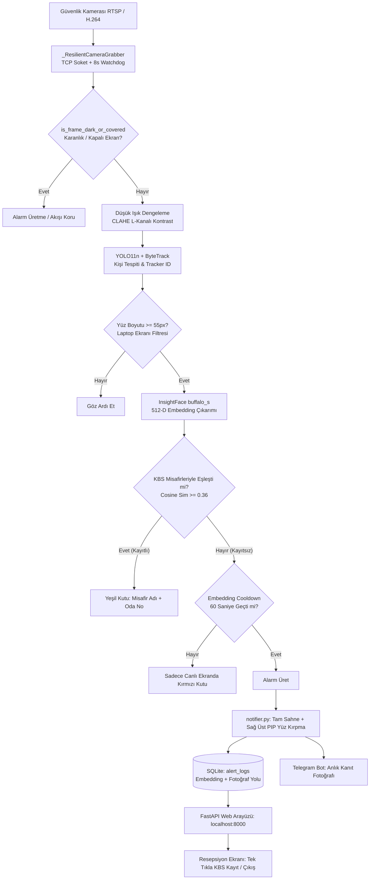

# 🏨 OTEL KAMERA — MANGO SUITES GÜVENLİK VE KBS DENETİM SİSTEMİ
## Yapay Zeka Ajanları ve Geliştiriciler İçin Kapsamlı Proje El Kitabı (Hand-off Documentation)

> **Bu Belgenin Amacı:** Bu proje üzerinde daha sonra çalışacak herhangi bir **Yapay Zeka (AI) asistanı** veya **yazılım geliştiricinin** sistemin tüm mimarisini, çözülmüş kritik problemleri, veritabanı şemasını ve çalışma prensiplerini hiçbir bilgi kaybı olmadan saniyeler içinde anlayabilmesi için hazırlanmıştır.

---

## 📌 1. Projeye Genel Bakış ve Amaç
* **Proje Adı:** `Otel Kamera` (Mango Suites Hotel Sentinel)
* **Temel İşlev:** Otelin güvenlik kamerasından gelen canlı görüntüyü yerel yapay zeka modelleriyle işleyerek:
  1. **KBS Kayıtlı Misafirleri Tanıma:** Resepsiyonda konaklayan kişilerin yüzlerini tanıyıp yeşil çerçeveyle doğrulamak.
  2. **Kaçak / Tanımsız Girişleri Yakalama:** KBS kaydı bulunmayan yabancı kişileri kat/merdiven geçişinde yakalamak.
  3. **Telegram Anlık Kanıt Bildirimi:** Yakalanan kişinin hem tam sahne görüntüsünü hem de sağ üst köşeye **yakınlaştırılmış yüzünü (PIP - Picture in Picture)** basarak Telegram grubuna anında göndermek.
  4. **Kameraya Tekrar Geçmeden Kayıt:** Misafirin yanında sonradan gelen arkadaşı kameranın önüne tekrar geçmek zorunda kalmadan, paneldeki "Yakalanan Yüzler" listesinden tek tıkla oda numarası girilerek KBS'ye kaydedilebilir.
  5. **Tekil Çıkış (Check-out):** Aynı odada kalan 2-3 kişiden sadece biri ayrıldığında diğerlerinin kaydı bozulmadan yalnızca ayrılan kişinin çıkışı yapılabilir.

---

## 🏗️ 2. Sistem Mimarisi ve Veri Akışı



---

## 📂 3. Dosya ve Dizin Düzeni

```text
Otel Kamera/
├── web_app.py                               # FastAPI Web Sunucusu, Güvenlik Başlıkları & REST API'ler
├── security_service.py                      # Kesintisiz RTSP Kamera Okuyucu, Watchdog & 30 Günlük Hafıza Temizliği
├── face_engine.py                           # InsightFace (buffalo_s) ONNX Yüz Tanıma & Benzerlik Karşılaştırma
├── tracker.py                               # Ultralytics YOLO11n + ByteTrack Kişi Takibi & Alarm Karar Motoru
├── database.py                              # SQLite WAL Veritabanı (Çoklu Açı Yüz Profilleri & Mükerrer Engelleme)
├── notifier.py                              # Telegram Botu & Sağ Üst Yakınlaştırılmış Yüz (PIP) Kompozisyonu
├── config.py                                # Merkezi Sistem, Kamera, Güvenlik ve Eşik Ayarları
├── .env                                     # Kamera RTSP Linki, Telegram Token ve Parametreler
├── .env.example                             # Örnek Konfigürasyon Şablonu
├── requirements.txt                         # Python Bağımlılıkları (fastapi, uvicorn, opencv, insightface, ultralytics)
├── yolo11n.pt                               # YOLO11 Nano Eğitilmiş Model Ağırlıkları
├── hotel_guests.db                          # Canlı SQLite Veritabanı
├── static/
│   └── index.html                           # Modern Resepsiyon Yönetim Konsolu (Taste-skill / Shadcn Tasarım)
├── alerts/                                  # Yakalanan tanımsız kişilerin kanıt fotoğrafları (30 gün saklanır)
├── guest_photos/                            # KBS kayıtlı misafirlerin vesikalık fotoğrafları
├── test_system.py                           # Baştan sona tüm sistemi doğrulayan otomatik test paketi
├── Baslat_Mac                               # macOS Tıkla-Çalıştır Başlatıcı (tmux entegreli)
├── Durdur_Mac                               # macOS Tek Tıkla Sistemi Kapatıcı
├── Otel_Ilk_Kurulum_Windows.bat             # Windows Bilgisayarda Python Sanal Ortamını Kuran Sihirbaz (1 Kez Tıklanır)
├── Otel_Baslat_Windows.bat                  # Windows Başlatıcı + Otomatik Tarayıcı Açıcı + Çökme Bekçisi
├── Otel_Otomatik_Baslangica_Kur_Windows.bat # Elektrik kesintisi sonrası bilgisayar açılınca sistemi gizli başlatan servis
├── README.md                                # Hızlı Başlangıç Kılavuzu
└── AI_GELISTIRICI_NOTLARI.md                # (Bu dosya) Gelecekteki geliştiriciler ve AI için teknik el kitabı
```

---

## 🧠 4. Çözülen Kritik Problemler ve Mühendislik Kararları

Geliştirme sürecinde karşılaşılan ve çözülen problemler:

### 1. Siyah / Kapalı Kamera Ekranında Yanlış Alarm Üretilmesi
* **Sorun:** Kamera lensi kapatıldığında veya gece kızılötesi geçişinde siyah ekranda rastgele gürültü sebebiyle yanlış yüz alarmları tetikleniyordu.
* **Çözüm:** [`security_service.py`](security_service.py) içine `is_frame_dark_or_covered(frame)` eklendi. Ortalama parlaklık (Luminance) < 18 veya standart sapma < 8 ise kare anında elenir, alarm tetiklenmez.

### 2. Yandan Bakış (Profil) ile Karşıdan Bakış Eşleşmeme Problemi
* **Sorun:** Misafir kameraya 90° profilden baktığında tek bir açıdan alınan fotoğraf bazen tanınamayabiliyordu.
* **Çözüm:** [`database.py`](database.py) içinde **Çoklu Açı Yüz Profilleri (`guest_face_profiles`)** yapısı kuruldu. Bir misafir için 5 farklı açıdan (ön, sağ profil, sol profil) yüz embedding'i saklanabilir. Tanıma motoru misafirin herhangi bir açısıyla eşleştiğinde kişiyi yeşil olarak doğrular.
* **Eşik Değeri:** `FACE_SIMILARITY_THRESHOLD = 0.36` olarak kalibre edildi (InsightFace `buffalo_s` için ideal denge).

### 3. Resepsiyon Masasındaki Bilgisayar/Laptop Ekranlarındaki Yüzler
* **Sorun:** Resepsiyon görevlisinin laptop ekranında görünen bir aktör veya video görüntüsü alarm üretiyordu.
* **Çözüm:** [`tracker.py`](tracker.py) içine `min_face_size = 55px` piksel sınırı ve YOLO gövde-yüz örtüşme doğrulaması eklendi. Ekranda uzakta kalan küçük pikselli yüzler filtrelenir.

### 4. Xiaomi Wi-Fi Menzil Genişletici ve Elektrik Kesintisi Dayanıklılığı
* **Sorun:** Otelde kamera kabloyla modeme, bilgisayar ise Xiaomi Wi-Fi güçlendirici ile modeme bağlıdır. Elektrik kesintisinde kamera ve sinyal güçlendirici geç açıldığında OpenCV `cv2.VideoCapture` sonsuza kadar kilitleniyordu.
* **Çözüm:** [`security_service.py`](security_service.py) içine `_ResilientCameraGrabber` yazıldı:
  * RTSP bağlantısı **TCP üzerinden zorlanır** (`rtsp_transport=tcp`), paket kaybı önlenir.
  * Soket zaman aşımı 5 saniyeye çekildi (`stimeout=5000000`).
  * Ayrı bir **Watchdog Thread** her 8 saniyede bir yeni kare gelip gelmediğini denetler; 8 saniye boyunca donma olursa kamerayı arka planda otomatik yeniden bağlar.
  * Windows bilgisayarın uykuya / ekran koruyucuya geçip ağı kapatmasını önlemek için Win32 `SetThreadExecutionState` kancası entegre edildi.

### 5. Disk Hafızasının Dolması ve 30 Günlük Saklama Politikası
* **Sorun:** Sürekli alarm fotoğrafları kaydedildiğinde otel bilgisayarının diski dolabilirdi.
* **Çözüm:** [`database.py`](database.py) içine `run_storage_maintenance()` motoru eklendi:
  * Otel kamerasının 30 günlük hafızasına sadık kalınarak **30 günden eski tüm fotoğraflar diskten ve veritabanından otomatik silinir**.
  * Aynı yabancı kişinin son 12 saat içinde çekilmiş mükerrer fotoğrafları yüz benzerliği (`DEDUP_SIMILARITY_THRESHOLD = 0.46`) ile tekilleştirilir, yalnızca en net ve en güncel kare tutulur.
  * Veritabanında kaydı kalmayan sahipsiz (orphan) tüm `.jpg` dosyaları otomatik temizlenir.

### 6. Ağ Güvenliği ve KVKK Koruma Kalkanı
* **Sorun:** Otel Wi-Fi ağına bağlanan misafirlerin tarayıcılarından `http://<bilgisayar-ip>:8000` yazarak canlı kamerayı ve diğer misafirlerin isim/oda listesini görme riski vardı.
* **Çözüm:**
  * [`config.py`](config.py) içinde `WEB_HOST = "127.0.0.1"` yapıldı; dış IP'lerden gelen tüm istekler engellendi. Panele **yalnızca resepsiyon bilgisayarının kendi ekranından** erişilebilir.
  * [`static/index.html`](static/index.html) içine HTML karakterlerini temizleyen `esc()` fonksiyonu eklenerek DOM XSS açıkları kapatıldı.
  * Sunucu seviyesinde `X-Frame-Options: DENY`, `X-Content-Type-Options: nosniff` ve `Cache-Control: no-store` güvenlik başlıkları eklendi.
  * Fotoğraf yükleme API'sine 10 MB boyut sınırı (`MAX_UPLOAD_BYTES`) getirildi.

---

## 🗄️ 5. Veritabanı Şeması (SQLite)

Veritabanı `hotel_guests.db` SQLite WAL (Write-Ahead Logging) modunda çalışır:

```sql
-- 1. Misafir Bilgileri Tablosu
CREATE TABLE IF NOT EXISTS guests (
    id INTEGER PRIMARY KEY AUTOINCREMENT,
    name TEXT NOT NULL,
    room_number TEXT NOT NULL,
    face_embedding BLOB,               -- 512 elemanlı float32 numpy vektörü
    photo_path TEXT,                   -- guest_photos/ klasöründeki vesikalık yolu
    check_in_date DATETIME NOT NULL,
    check_out_date DATETIME NOT NULL,
    is_active INTEGER DEFAULT 1,       -- 1: Konaklıyor, 0: Çıkış yaptı
    created_at DATETIME DEFAULT CURRENT_TIMESTAMP
);

-- 2. Çoklu Açı Yüz İmzaları Tablosu (Multi-Angle Profiles)
CREATE TABLE IF NOT EXISTS guest_face_profiles (
    id INTEGER PRIMARY KEY AUTOINCREMENT,
    guest_id INTEGER NOT NULL,
    face_embedding BLOB NOT NULL,       -- Farklı açılardan alınan 512-D embedding
    angle_label TEXT DEFAULT 'front',  -- 'front', 'side', 'angled'
    created_at DATETIME DEFAULT CURRENT_TIMESTAMP,
    FOREIGN KEY(guest_id) REFERENCES guests(id) ON DELETE CASCADE
);

-- 3. Yetkisiz / Tanımsız Giriş Alarmları Tablosu
CREATE TABLE IF NOT EXISTS alert_logs (
    id INTEGER PRIMARY KEY AUTOINCREMENT,
    alert_time DATETIME NOT NULL,
    image_path TEXT NOT NULL,           -- alerts/ klasöründeki tam sahne resmi
    face_crop_path TEXT,                -- alerts/ klasöründeki yakınlaştırılmış yüz resmi
    embedding BLOB,                     -- Kişiyi sonradan kameraya gelmeden kaydetmek için 512-D embedding
    details TEXT
);
```

---

## ⚙️ 6. Konfigürasyon Parametreleri (`.env`)

| Değişken | Varsayılan | Açıklama |
| :--- | :--- | :--- |
| `CAMERA_SOURCE` | `0` | RTSP kamera linki (Örn: `rtsp://192.168.1.64:554/stream1`; kullanıcı adı ve şifre kamera kurulumunda adresin başına eklenir) veya yerel kamera indeksi |
| `CAMERA_LOCATION` | `Merdiven / Kat Girisi` | Bildirimlerde ve ekranda görünen kamera konumu |
| `FACE_SIMILARITY_THRESHOLD`| `0.36` | Kosinüs benzerlik eşiği (0.36 ve üzeri = Aynı Kişi / Kayıtlı Misafir) |
| `MIN_FACE_DET_SCORE` | `0.62` | Yüz algılama güven skoru (düşük kaliteli yüzleri eler) |
| `MIN_FACE_SIZE_PX` | `55` | Minimum yüz boyutu (arka plandaki laptop ekranlarını eler) |
| `PROCESS_EVERY_N_FRAMES` | `3` | Her N karede bir yapay zeka çalıştırma (CPU tasarrufu sağlar) |
| `ALARM_COOLDOWN_SECONDS` | `60` | Aynı kişi kameranın önünde dururken tekrar tekrar alarm üretilmesini önler |
| `TELEGRAM_BOT_TOKEN` | `""` | Telegram Bot Token (`botfather` üzerinden alınan) |
| `TELEGRAM_CHAT_ID` | `""` | Bildirim gidecek Telegram Grup ID'si (Örn: `-100123456789`) |
| `ALERT_RETENTION_DAYS` | `30` | Kaç gün geriye dönük alarm fotoğrafı saklanacağı (Otel kamerasıyla senkron) |
| `WEB_HOST` | `127.0.0.1` | Güvenlik: Sadece yerel resepsiyon bilgisayarı erişimi |
| `WEB_PORT` | `8000` | Web konsol portu |

---

## 🚀 7. Oteldeki Bilgisayar Tamir Edildiğinde Yapılacaklar (Adım Adım Çalıştırma)

Oteldeki bilgisayar onarıldığında veya yeni bir bilgisayar bağlandığında şu adımları takip edin:

1. **Projeyi Bilgisayara İndirin:**
   * Google Drive'a yüklediğimiz `Otel Kamera.zip` arşivini otelin Windows bilgisayarına indirin ve klasörü Masaüstüne çıkarın (`C:\Users\<Kullanıcı>\Desktop\Otel Kamera`).
2. **Python Kurulumunu Kontrol Edin:**
   * Bilgisayarda Python 3.11 veya 3.12 kurulu olmalıdır. Kurulum sırasında pencerenin en altındaki **`Add Python to PATH`** seçeneğinin işaretli olduğundan emin olun.
3. **Kamera RTSP Linkini ve Telegram Bilgilerini Girin:**
   * Klasördeki `.env` dosyasını Not Defteri ile açın.
   * `CAMERA_SOURCE=...` satırına kamera ustasından alınan RTSP bağlantısını yazın.
   * `TELEGRAM_BOT_TOKEN` ve `TELEGRAM_CHAT_ID` satırlarına otelin bildirim grubunu girin.
4. **İlk Kurulum Sihirbazını Çalıştırın (Sadece 1 Kez):**
   * [`Otel_Ilk_Kurulum_Windows.bat`](Otel_Ilk_Kurulum_Windows.bat) dosyasına çift tıklayın. Gerekli kütüphaneler otomatik kurulacaktır.
5. **Elektrik Kesintisi Sonrası Otomatik Başlatmayı Aktif Edin:**
   * [`Otel_Otomatik_Baslangica_Kur_Windows.bat`](Otel_Otomatik_Baslangica_Kur_Windows.bat) dosyasına çift tıklayın.
   * Artık resepsiyon görevlileri bilgisayarı açtığında sistem arka planda otomatik çalışacak ve resepsiyon ekranında `http://localhost:8000` açılacaktır.

---

## 🧪 8. Test Paketi Nasıl Çalıştırılır?

Sistemin veritabanını, yüz tanıma motorunu, güvenlik filtrelerini ve yakınlaştırma algoritmalarını doğrulamak için terminalde şu komutu çalıştırabilirsiniz:

```bash
./venv/bin/python test_system.py
```

Tüm testler yeşil (`TÜM TESTLER GEÇTİ! OTEL KAMERA SİSTEMİ %100 HAZIR.`) olarak sonuçlanmalıdır.

---

## 📋 9. Mevcut Durum Özeti (Hand-Off State)
* **Yazılım Durumu:** %100 Tamamlandı, test edildi, temizlendi ve donduruldu.
* **Neden Duraklatıldı:** Oteldeki resepsiyon bilgisayarı fiziksel arıza yaptığı için otel tarafındaki saha montajına ve canlı kamera testine geçici olarak ara verildi.
* **Gelecekteki Geliştiriciye Not:** Projenin mantığı eksiksizdir; kodlarda hiçbir eksik veya yarım kalmış fonksiyon yoktur. Yeni bilgisayar geldiğinde yalnızca `.env` dosyasındaki kamera adresi güncellenip `.bat` dosyasıyla başlatılacaktır.
